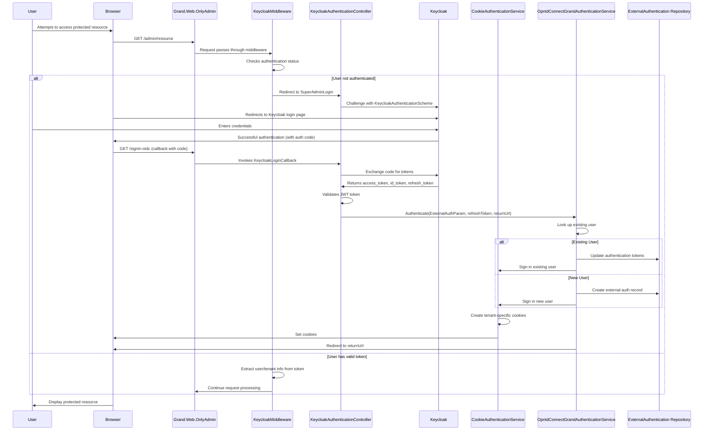
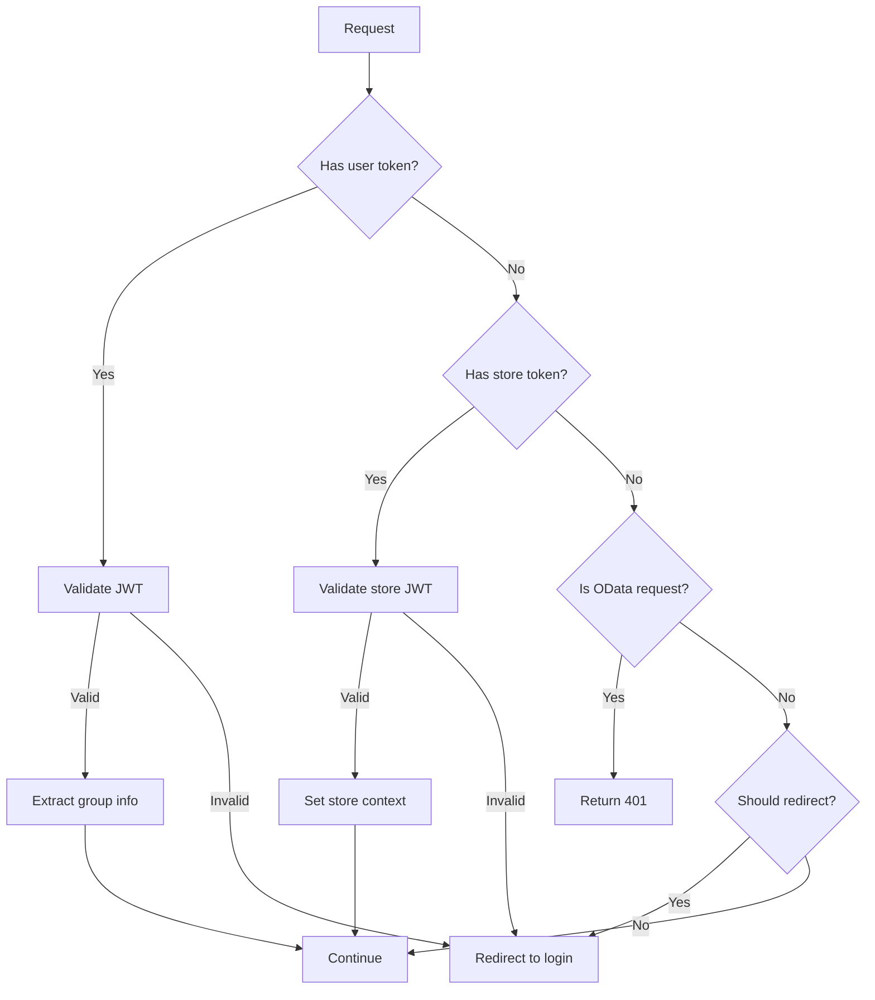
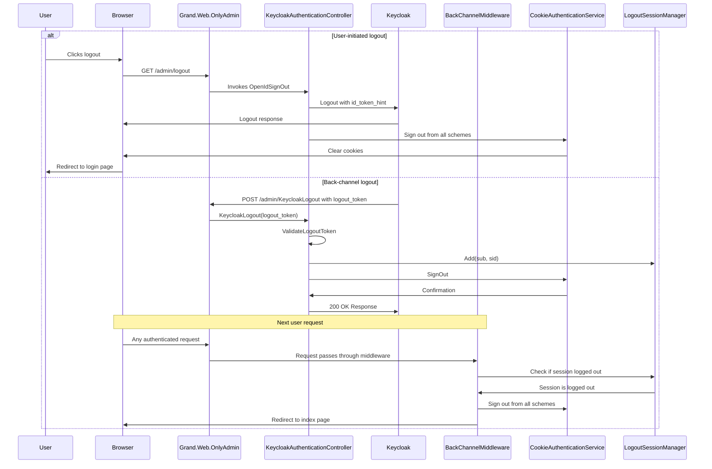
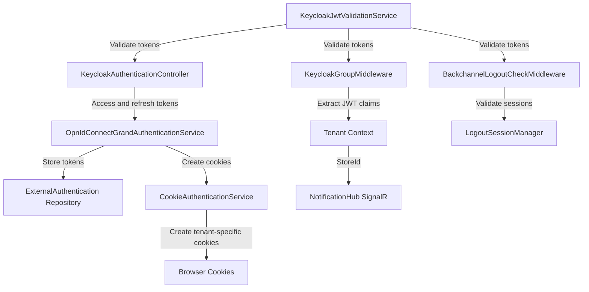
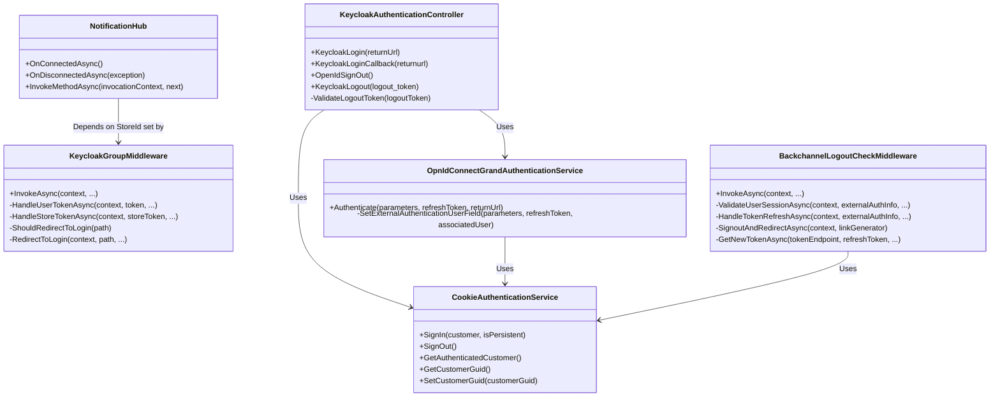

# Keycloak Authentication Flow

This document outlines the authentication flow between the application and Keycloak, showing both the login and logout processes.

## Login Flow

## Middleware Processing

## Logout Flow

## Data Flow for Authentication

## Component Relationships

This documentation visualizes the complete authentication flow between the application, Keycloak, and various middleware components, highlighting how tenant-specific data is maintained throughout the process.