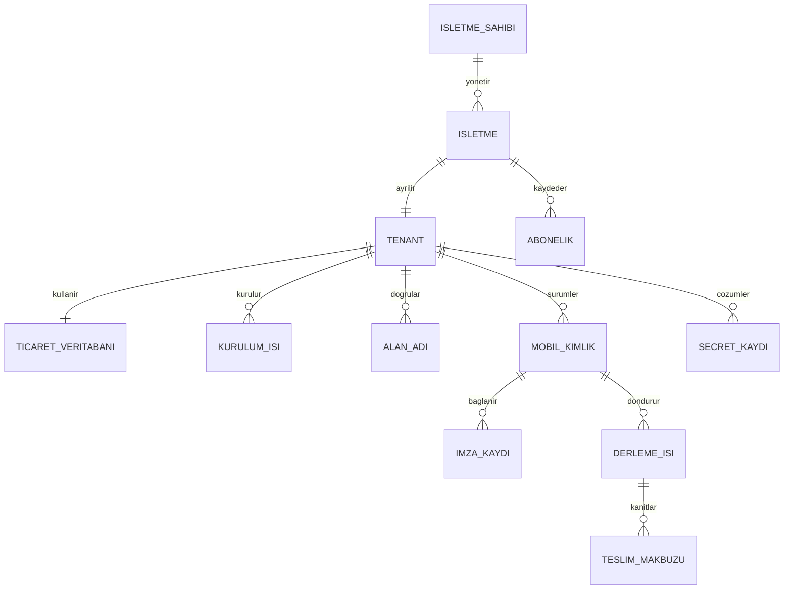
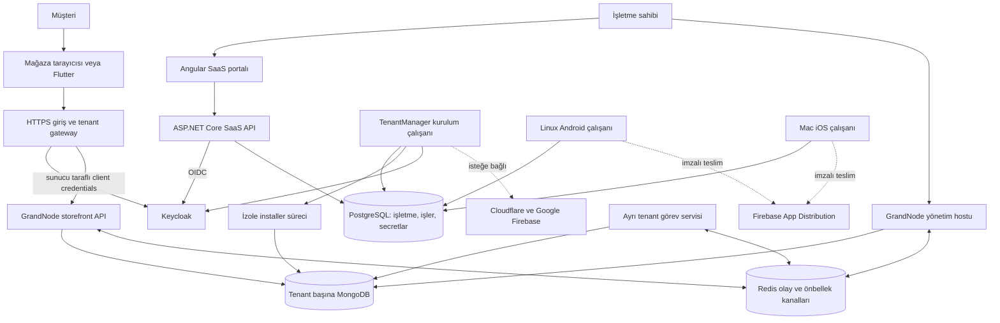
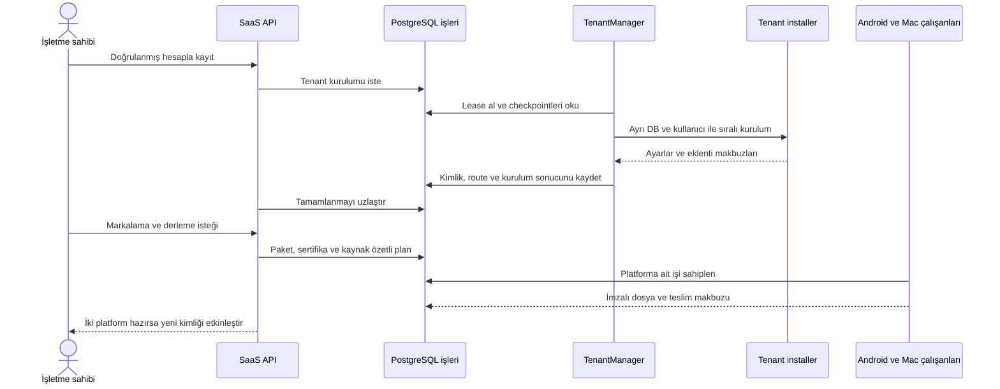

# Multi-tenant Commerce Platform

**Bir işletme kaydından ayrı mağaza, yönetim paneli ve işletmeye özel mobil uygulama teslimine uzanan .NET, Angular ve Flutter platformu.**

Bu proje, GrandNode tabanlı ticaret motoruna çok kiracılı bir işletim katmanı ekler. İşletmeler ortak uygulama süreçlerini kullanırken ticaret verileri ayrı MongoDB veritabanları ve sınırlı kullanıcılarla tutulur. SaaS portalı; işletme kaydı, kurulum durumu, alan adı, mobil kimlik ve derleme süreçlerini yönetir. Keycloak kimlik, PostgreSQL kalıcı iş/secret durumu, Redis süreçler arası olaylar, Docker Compose ise taşınabilir dağıtım için kullanılır.

Projenin amacı artık **tekrarlanabilir bir mühendislik örneği ve portföy çalışması** sunmaktır. Çıkış noktası, küçük işletmelerin sunucu ve veritabanı maliyetini paylaşabilmesiydi. Bu repo, tek geliştiriciyle yürütülen ticari denemeden kalan kararları, çalışan otomasyonu ve sınırlarını görünür kılar; ücretli hizmet veya satışa hazır SaaS vaadi taşımaz.

> **Yayın hazırlığı:** Yazara ait bağımsız kodlar GPL-3.0-only olarak lisanslanmıştır. Flutter ekranları ve Riverpod/API katmanları yazara aittir; satın alınmış UI kiti renk/tema referansıdır. Mevcut tema, resim ve ikonlar korunur; yalnız somut kısıt bulunan dosyalar değiştirilir. Güncel adayın kontrolleri tarihli kayıtlarda belirtilir; GitHub görünürlüğü hâlen private durumdadır. İlk public sürüm temiz geçmişle hazırlanmalıdır. Güncel dosya temizliği, eski Git commitlerindeki kopyaları kaldırmaz. [Lisans kapsamı](LICENSING.md) · [Hak incelemesi](docs/LICENSE_REVIEW.md) · [Yayın kapısı](docs/PUBLIC_RELEASE.md) · [Bu hazırlığın doğrulaması](docs/validation/open-source-preparation-20261018.json).

## İçindekiler

- [Neyi gösteriyor?](#neyi-gösteriyor)
- [Çalışan kapsam ve doğrulama sınırları](#çalışan-kapsam-ve-doğrulama-sınırları)
- [Kavramsal model](#kavramsal-model)
- [Mimari](#mimari)
- [Yeni işletmenin yolculuğu](#yeni-işletmenin-yolculuğu)
- [Teknolojiler ve sorumluluklar](#teknolojiler-ve-sorumluluklar)
- [Yerelde çalıştırma](#yerelde-çalıştırma)
- [Sunucu ve mobil dağıtımı](#sunucu-ve-mobil-dağıtımı)
- [Güvenlik ve veri sınırları](#güvenlik-ve-veri-sınırları)
- [Testler ve kanıtlar](#testler-ve-kanıtlar)
- [Kod içinde okuma rotası](#kod-içinde-okuma-rotası)
- [Katkı ve yol haritası](#katkı-ve-yol-haritası)
- [Lisans ve teşekkür](#lisans-ve-teşekkür)

## Neyi gösteriyor?

- İki örnek tenant ve portaldan yeni deneme işletmesi oluşturabilen bulutsuz web demosu.
- Tenant başına veritabanı/kullanıcı, sunucuda tutulan Keycloak istemci bilgileri ve tenant doğrulaması.
- Süreç kesintisinden sonra devam eden PostgreSQL iş kuyruğu, lease, checkpoint ve kontrollü yeniden deneme.
- DI üzerinden seçilen Local/Portable veya Azure şifreleme sağlayıcısı ve dağıtık tenant secret deposu.
- Ayrı storefront, admin, installer ve görev süreçleri; role göre doğru eklenti çıktıları.
- Açıkça etkinleştirilen Cloudflare alan adı, Google/Firebase kurulumu ve paket başına mobil imza geçmişi.
- Linux Android çalışanı ile Mac iOS çalışanının aynı değişmez derleme planında buluşması.
- İşletme markalaması, Android FCM / iOS doğrudan APNs ve tenant görevlerinin ayrı çalıştırılması.

GrandNode'un katalog, sepet, sipariş ve eklenti motoru bu projenin sıfırdan yazılmış parçası değildir. Projeye özgü katkı; bu motoru SaaS kaydı, tenant izolasyonu, kurulum, alan adı, mobil kimlik, teslim ve işletim süreçleriyle birleştiren katmandır.

## Çalışan kapsam ve doğrulama sınırları

“Yerel” bulut hesabı gerektirmeyen profili; “canlı kabul” ise özel test ortamında gerçekten yapılan, tarihli ve belirli kaynak sürümlerine ait denemeyi anlatır. Canlı kabulün geçmiş olması, bu hazırlık sürümünün tamamının yeniden aynı ortamda test edildiği anlamına gelmez.

| Alan | Gerçekleştirilen | Açık sınır |
| --- | --- | --- |
| Yerel web | İki mağaza, katalog/ürün/sepet, admin, Keycloak, yeni işletme ve negatif izolasyon kontrolleri | Development profili; internete açılmaz |
| Linux dağıtımı | Docker Compose, HTTPS, gerçek portal kaydı/e-posta doğrulaması, yeniden başlatma ve yedekten dönüş | Üretim SLA'sı, yük/kaos testi veya çok düğümlü HA kabulü yok |
| Tenant kurulumu | Sıralı installer görevleri, eklentiler, para birimi, %1/%10/%20 vergi kategorileri ve mobil adres alanları | Sonradan değişen küresel ayar tamamlanmış tenant'ı sessizce yeniden kurmaz |
| Özel alan adı | Cloudflare erişimi, tek tenant tahsisi, TXT sahipliği, DNS/TLS ve mağaza/admin ayrımı canlıda doğrulandı | DNS değişikliği açık yapılandırma gerektirir; çakışmalar reddedilir |
| Mobil kimlik | Aynı Firebase projesinde yeni Android/iOS uygulamaları, sertifika geçmişi, iki imzalı çıktı sonrası aktivasyon | Mağazalardaki mevcut uygulamanın paket kimliğini yerinde değiştirmez |
| Android teslimi | İmzalı APK, gerçek sertifika parmak izleri, Firebase App Distribution yükleme ve bağımsız indirme | Fiziksel Android cihazda bildirim kaydı/teslim kabulü bekliyor |
| iOS teslimi | İmzalı Ad Hoc IPA, semboller, App Distribution, gerçek iPhone'da mağaza ve markalama | Mac ve Apple hesabı gerekir; gözetimsiz Keychain erişimi kabul edilmedi |
| Bildirim | Gerçek admin gönderimi → iPhone APNs teslimi → bildirime dokununca sepet; işletme ikonu kullanıcı tarafından doğrulandı | Gerçek crash raporu ve tüm dış universal-link/soğuk açılış çeşitleri kabul edilmedi |
| Ayrı görev servisi | Test tenant'ında etkin 10 görevin çalışması; tenant lease ve görev sırası | Tüm işletmelerin bütün görevleri otomatik olarak etkin sayılmaz |
| Ödeme/entegrasyon | Iyzico ve çeşitli eski entegrasyon kaynakları mevcut | Gerçek tahsilat/iade, POS, pazaryeri, kurye, e-fatura ve stok senkronizasyonu kabulü yok |
| Mobil tema/varlıklar | Mevcut tema, ikonlar ve örnek görseller korunur; görsel yenileme geri alındı | Koruma kararı lisans grant'i değildir; [kayıt](docs/licenses/ASSET_RETENTION.md) |

Tarihli kayıtlar ve kullanılan commitler: [Doğrulama geçmişi](docs/VALIDATION.md). Bu hazırlıkta uzak GitHub Actions koşturulmadı; önceki uzak denemede hesap kotası engeli vardı. Yerel Linux kaynak aşamasının sonucu [hazırlık kaydındadır](docs/validation/open-source-preparation-20261018.json); sonraki görsel geri almanın kontrolleri [ayrı kayıttadır](docs/validation/asset-restoration-20261018.json); eski yeşil sonuçlar güncel kaynağın tam CI sonucu olarak sunulmaz.

## Kavramsal model

Aşağıdaki şema kavramsaldır; fiziksel tablo/collection şeması değildir.



Yerel kayıt arayüzü hesap başına tek işletmeyle sınırlıdır. Kavramsal sahiplik ilişkisi çok işletmeli portal kullanımının bütün ekranlarda kabul edildiğini iddia etmez. Tenant; veritabanı, route, kimlik ve görevlerin ortak ayrım anahtarıdır. Secret değerleri iş kuyruğuna veya mobil ayarlara gömülmez; çalışma anında yetkili sunucu tarafından çözülür.

## Mimari



Bu yapı birkaç ayrı process/host ile çalışan, ortak ticaret modülleri ve veri sözleşmeleri bulunan bir sistemdir. Repo monorepodur; bu, tüm parçaların tek process olduğu anlamına gelmez. Her parçanın bağımsız veri sahipliğine sahip olduğu saf mikroservis mimarisi veya tamamı event-sourced bir DDD örneği olduğu iddia edilmez.

İki çalışma yolu bulunur:

| Profil | Kullanım | Dış hesap gereksinimi |
| --- | --- | --- |
| Local demo | Makinede HTTP/loopback; sentetik mağazalar ve yerel sağlayıcılar | Yok |
| Portable Production | Linux Compose + HTTPS; özel girdilerle gerçek sağlayıcılar | Seçilen DNS, SMTP, Google/Firebase ve Apple hizmetlerine göre |
| Eski Azure akışı | Korunan yardımcılar ve Azure şifreleme adaptörü | Ayrı eski yapılandırma; Portable kabulü Azure kaynaklarının doğrulaması değildir |

[Detaylı mimari ve güven sınırları](docs/ARCHITECTURE.md) · [Teknoloji tercihleri](docs/TECHNOLOGY.md) · [12 mimari karar kaydı](docs/decisions/README.md).

## Yeni işletmenin yolculuğu



Bulut adımları yalnız etkin sağlayıcılarda çalışır. Local demo gerçek Google projesi oluşturmaz, karttan para çekmez veya uygulama imzalamaz. Kesintilerde biten adımlar checkpoint üzerinden bulunur; dış sistemlerdeki yan etkiler uzlaştırılır. Bu model dağıtık bir ACID transaction veya “exactly once” dış API yürütme garantisi değildir.

Alan adı daha sonra değiştirildiğinde mağaza ayarları baştan kurulmaz. Yeni paket adı istenirse aynı Firebase projesinde yeni uygulama çifti ve imza kayıtları açılır; eski çalışan kimlik, iki yeni imzalı çıktı doğrulanana kadar aktif kalır. [Adım adım işletme ekleme](docs/YENI_ISLETME_EKLEME.md) · [Domain ve mobil kimlik geçişi](docs/TENANT_DOMAINS_AND_MOBILE_IDENTITIES.md).

## Teknolojiler ve sorumluluklar

Sürümler mevcut kaynak/lock/config girdilerini anlatır; güncel destek ömrü veya en son sürüm iddiası değildir.

| Proje | Teknoloji | Buradaki görevi |
| --- | --- | --- |
| `Ecommerce/` | .NET 8, ASP.NET Core, GrandNode, MongoDB | Katalog/sepet/sipariş; storefront, admin ve installer hostları |
| `SaasManager/` | .NET 9, EF Core + Npgsql, Angular 18, NgRx/RxJS | İşletme/abonelik verisi ve kullanıcıya kurulum/derleme ekranları |
| `Shared/Platform.Security/` | DI, AES-GCM veya Azure sağlayıcısı, Npgsql | Tenant secret sözleşmesi ve şifreli PostgreSQL saklama |
| `Shared/Platform.Provisioning*` | PostgreSQL, açık SQL, lease/checkpoint | Kalıcı işler, sahiplik, tekrar deneme ve seçilen kurulum adımları |
| `TenantManager/` | .NET çalışanları ve ayrı child processler | Installer, yayın ve tenant görev yürütmesi |
| `tools/` ve `scripts/` | .NET araçları, Python, Ruby, Gradle, Xcode | Gateway, cloud/owner araçları, dağıtım ve platform derlemeleri |
| `Platforms/` | Flutter/Dart, Riverpod, Dio, AutoRoute | Tenant mağaza istemcisi ve bağımsız Riverpod/API katmanı |
| `cloudflare_image_resizing_worker/` | TypeScript, Cloudflare Workers | Local demo dışında kalan isteğe bağlı görsel dönüştürme örneği |
| `infra/` | Docker Compose, OCI Terraform/Resource Manager | Tek Linux test kurulumu ve açık maliyet/temizleme sınırları |
| Kimlik | Keycloak 26.8, OIDC/JWT | Portal kullanıcıları ve sunucular arası tenant istemcileri |
| Ortak altyapı | PostgreSQL 16, MongoDB 8, Redis 7.4 | İlişkisel kontrol verisi, tenant ticaret verisi ve geçici olay/önbellek |

SaaS veritabanında **Entity Framework kullanılır**. Kuyruk ve secret katmanındaki doğrudan Npgsql kullanımı; lease alma, fencing ve dar transactionların açık yönetimi içindir. Ayrıntılar ve bedeller: [Teknoloji tablosu](docs/TECHNOLOGY.md), [ADR-002](docs/decisions/0002-persistence.md).

## Yerelde çalıştırma

### Gerekenler

- macOS veya Linux; Windows için WSL2 yolu ayrıca kendi ortamınızda doğrulanmalıdır.
- Çalışan Docker ve Docker Compose v2.
- .NET **8 ve 9 SDK** birlikte; Node.js **22**, npm ve Python **3.10+**.
- Paket indirmeleri için internet ve web demosuna en az 10 GB boş alan. Mobil SDK/cache/derlemeleri çok daha fazla alan ister.
- Boş portlar: `18080`, `18081`, `18082`, `18083`, `18090`, `27028`, `15439`, `16389`.

Hazırlık sürümü hâlen private olan `codex/local-demo` dalındadır; bu komut erişim yetkisi gerektirir. Public sürüm oluşturulduğunda klonlama bilgisi o sürümün gerçek dal/etiketine göre güncellenmelidir.

```sh
git clone --branch codex/local-demo --single-branch https://github.com/osman-kabasakal/multi-tenant-commerce-platform.git
cd multi-tenant-commerce-platform
python3 scripts/demo.py check
python3 scripts/demo.py up
python3 scripts/demo.py smoke
```

`up`; rastgele parolaları ve yerel ayarları üretir, altyapıyı başlatır, gerçek .NET uygulamalarını derler ve iki sentetik mağazayı kurar. Loglar `.local/logs/`, parolalar `.local/credentials.json` altındadır. İlk çalıştırmada paket indirmeleri nedeniyle bekleme olabilir. Aynı veri birimleriyle tekrar çalıştırıldığında parolalar ve şifreleme anahtarları korunmalıdır.

| Adres | Kullanım | Hesap / parola alanı |
| --- | --- | --- |
| `http://demo-a.localhost:18090` | Demo Coffee | Ziyaretçi |
| `http://demo-b.localhost:18090` | Demo Books | Ziyaretçi |
| `http://demo-a.localhost:18083/Admin` | Coffee yönetimi | `demo-a@example.test` / `store_admin` |
| `http://demo-b.localhost:18083/Admin` | Books yönetimi | `demo-b@example.test` / `store_admin` |
| `http://localhost:18081` | SaaS portalı | `demo-owner` / `saas_user` |
| `http://localhost:18081/api/Auth/login?returnUrl=/` | SaaS OIDC girişi | `demo-owner` / `saas_user` |
| `http://localhost:18081/local-onboarding.html` | Yeni yerel işletme | Giriş yapılmış `demo-owner` |
| `http://localhost:18080/admin` | Keycloak yönetimi | `demo-admin` / `keycloak_admin` |

Tablodaki parola alanları `.local/credentials.json` içindeki anahtar adlarıdır. Repo sabit parolalar içermez. `.localhost` çözülmüyorsa hosts dosyasına `127.0.0.1 demo-a.localhost demo-b.localhost` ekleyin. Mağaza yöneticisi bu profilde GrandNode parola akışını, SaaS portalı Keycloak OIDC akışını kullanır.

Deneme sırası:

1. İki mağazanın farklı kataloglarını ve sepetlerini açın.
2. Her yönetim hesabıyla kendi mağazasındaki ürünleri inceleyin.
3. Keycloak'ta ayrı tenant istemcilerini görün; `smoke` ile yanlış tenant/değiştirilmiş token reddini sınayın.
4. Yerel onboarding sayfasında işletme adı ve en az 12 karakter yönetim parolasıyla yeni deneme oluşturun.
5. Hazır durumundan verilen mağaza/yönetim bağlantılarını açın. Yerel abonelik denemedir, gerçek tahsilat yapılmaz.

```sh
# İki yeni test hesabıyla giriş, kurulum ve izolasyon akışı:
python3 scripts/smoke_onboarding.py

# Uygulamaları durdur:
python3 scripts/demo.py stop

# Kaynak değişmediyse aynı verilerle tekrar aç:
python3 scripts/demo.py infra
python3 scripts/demo.py start
```

Kaynak değişikliğinden sonra `up` tekrar derler. Tek parça için `python3 scripts/demo.py build --component commerce` kullanılabilir; `admin`, `installer`, `saas`, `worker` da desteklenir. Yeni çıktı, ilgili süreç yeniden başlatıldığında etkinleşir.

Tam temiz başlangıç **bu demo verilerini siler**:

```sh
python3 scripts/demo.py stop
docker compose --env-file .local/compose.env down --volumes
# Yalnız bu reponun .local klasörünü kaldırıp yeniden up çalıştırın.
```

Veri birimlerini koruyup `.local` içindeki anahtar/parolaları silmek, eski veriye erişimi kaybettirir. Ayrıntılı kurulum: [işletme rehberi](docs/YENI_ISLETME_EKLEME.md).

## Sunucu ve mobil dağıtımı

**Linux:** [Production rehberi](docs/LINUX_PRODUCTION.md), gerçek domain/TLS ve özel ayar dosyasıyla Compose kurulumunu anlatır. SDK'lar build imajlarında kullanılır. Varsayılan yerel HTTP/start-dev profili internete taşınmaz.

**Oracle:** [Dağıtım rehberi](docs/ORACLE_DEPLOYMENT.md), kendi hesabınızda Terraform/Resource Manager ve yerelden çalışan dağıtım aracı kullanır. GitHub Actions zorunlu değildir. Altyapı hazırlama, SSH ile özel kaynak aktarımı, Docker imajları, güncelleme ve yedekleme [ayrıntılı işletim açıklamasındadır](docs/ORACLE_SSH_DOCKER_DEPLOYMENT.md). Kimlik dosyaları, durdurma ve bütün test altyapısını silme sırası [test ve kaldırma rehberindedir](docs/ORACLE_TEST_VE_KALDIRMA.md). Bulut kaynakları ücret doğurabilir; test makinesinin otomatik durması disk/kayıtlı kaynakları silmez.

**Mobil:** [Mobil rehber](docs/MOBILE.md), [markalama](docs/MOBILE_BRANDING.md), [bildirim](docs/MOBILE_NOTIFICATIONS.md). Android Linux üzerinde; iOS yalnız Mac/Xcode ve Apple imzalama girdileriyle üretilir. Mevcut imzalı cihaz kabulleri, önceki özel test sürümüne aittir. Görsel/tema değişiklikleri sonrası yeniden cihaz kabulü gerekir. App Distribution teslimi, App Store/Google Play yayını anlamına gelmez.

Google/Firebase, Cloudflare, SMTP, FCM/APNs ve imzalama açıkça yapılandırılır. Geniş yetkili proje oluşturucu hesabı mobil uygulamaya veya bildirim göndericisine verilmez. [Google kurulumu](docs/GOOGLE_FIREBASE.md) · [Tenant kurulumu ve BuildType](docs/TENANT_INITIALIZATION.md).

## Güvenlik ve veri sınırları

- Portal sahibi OIDC ile; gateway sunucusu confidential client credentials ile doğrulanır. Mobil/tarayıcı içine Keycloak client secret konmaz.
- Commerce token üzerinde imza, issuer, audience, süre ve tenant bağını denetler. Host/paket bilgisi tek başına kullanıcı veya cihaz kimliği değildir.
- Tenant'ın Mongo kullanıcısı kendi veritabanıyla sınırlıdır. Ortak process, altyapı ve secret servisi nedeniyle fiziksel izolasyon iddiası yoktur.
- Secret kayıtları ortak arayüzden çözülür; Local/Portable AES-GCM için tüm yetkili süreçlerde aynı master key gerekir. DB yedeği tek başına anahtar kaybını telafi etmez.
- PostgreSQL owner bootstrap şema/yetki kurar; runtime uygulaması şema sahibi olarak çalışmaz.
- Storefront hostunda yönetim yolları açılmaz. Admin hostunun kendi kimlik/yetki kontrolü vardır.
- `.local`, gerçek müşteri kataloğu, servis hesabı JSON'u, anahtar, keystore, provisioning profile ve gerçek işletme görselleri dağıtıma girmez.

[Kimlik/gateway](docs/GATEWAY.md) · [Tenant secretları](docs/TENANT_SECURITY.md) · [DB yetkileri](docs/DATABASE_BOOTSTRAP.md) · [Güvenlik bildirme](SECURITY.md).

## Testler ve kanıtlar

| Katman | Ne sınanır? | Giriş |
| --- | --- | --- |
| Kaynak | Gizli/generated dosya adları, hashli lisans envanteri, temiz snapshot taraması | `scripts/check_public_source.py`, `scripts/asset_inventory.py`, `.github/workflows/verify.yml` |
| Sözleşme / entegrasyon | Gateway tenant reddi, kuyruk lease, provisioning, kayıt sahipliği, bildirim bağlama | `tests/` ve `SaasManager/tests/` |
| Gerçek bağımlılıklar | PostgreSQL/Mongo/Redis, installer ve yerel tarayıcı akışları | `scripts/smoke_*.py` |
| Mobil | Auth/cache, Firebase kimlik uyuşmazlığı, push kaydı, görsel davranış, platform araçları | `Platforms/store_user_app/test/`, `scripts/test_mobile_*.py` |
| Canlı kabul | DNS/HTTPS, ayrı indirilen imzalı dosya, gerçek iPhone ve kullanıcı gözlemi | `docs/validation/`, `docs/VALIDATION.md` |

Bu katmanlar birbirinin yerine geçmez. Bir mock testinin geçmesi gerçek APNs teslimi kanıtı değildir; eski canlı kabul de yeni UI'nin cihazda test edildiği anlamına gelmez. Devralınan bazı testler ve bağımlılık uyarıları vardır; bütün GrandNode testlerinin yeşil olduğu iddia edilmez. Sonuçları kaynak sürümüyle birlikte okuyun.

## Kod içinde okuma rotası

1. [Mimari](docs/ARCHITECTURE.md) ile process ve veri sınırlarını görün.
2. [SaaS DI](SaasManager/src/Infrastructure/DependencyInjection.cs) içinde EF/sağlayıcı seçimlerini inceleyin.
3. [ProvisioningWorker](Shared/Platform.Provisioning/ProvisioningWorker.cs) ve [PostgresProvisioningQueue](Shared/Platform.Provisioning/PostgresProvisioningQueue.cs) ile kesinti/lease modelini takip edin.
4. [Security DI](Shared/Platform.Security/DependencyInjection.cs) ve [secret deposu](Shared/Platform.Security/PostgresSecretStore.cs) ile sağlayıcı sınırını okuyun.
5. [Tenant çalışanı](TenantManager/Provisioning/WorkerHost.cs), [kurulum rehberi](docs/TENANT_INITIALIZATION.md) ve [görev servisi](docs/TENANT_BACKGROUND_TASKS.md) ile tenant hayat döngüsünü izleyin.
6. [Mobil kimlik geçişi](docs/TENANT_DOMAINS_AND_MOBILE_IDENTITIES.md), [Android aracı](scripts/mobile_android.py) ve [Mac çalışanı](scripts/mobile_ios_worker.py) ile teslim zincirini takip edin.
7. Her kararın gerekçesi ve bedeli için [ADR dizinine](docs/decisions/README.md) dönün.

CodeGraph isteğe bağlıdır. İndeksli çalışma kopyasında `codegraph explore "ProvisioningWorker PostgresSecretStore"` ile kaynak ve çağrı yolları incelenebilir. Yeni klonda indeks oluşturmak kullanıcının tercihidir; `.codegraph/` Git'e girmez ve demo için gerekli değildir.

## Katkı ve yol haritası

Öncelik; lisans temizliği, tekrarlanabilir demo, daha küçük bağımlılık yüzeyi ve testlerin anlaşılır olmasıdır. Ticari kapsamı büyüten POS, kurye, pazaryeri ve fatura entegrasyonları ayrı bir ürün kararıdır. [Önceliklendirilmiş yol haritası](docs/ROADMAP.md) · [Katkı rehberi](CONTRIBUTING.md).

Bir değişiklik gönderirken hedef profilini, tenant sınırlarını, değişen yapılandırmayı ve gerçekten koşturduğunuz kontrolleri belirtin. Gerçek kimlik bilgisi/müşteri görseli eklemeyin. Bildirim, kaynak oluşturma veya imzalama gerektiren testler açık sağlayıcı girdileri olmadan çalışmamalıdır.

## Lisans ve teşekkür

Yazara ait bağımsız kodlar **GPL-3.0-only**; GrandNode türevleri mevcut GPLv3 bildirimlerini korur. MIT/Apache/BSD/OFL/ISC bileşenler kendi lisanslarında kalır. Kök [LICENSE](LICENSE), üçüncü tarafın kodunu veya satın alınan temayı yeniden lisanslamaz. [Lisans kapsamı](LICENSING.md) · [Third-party notices](THIRD_PARTY_NOTICES.md) · [Değişiklik bildirimi](NOTICE.md).

GrandNode projesine, SaaS temelindeki Jason Taylor Clean Architecture şablonuna ve kullanılan açık kaynak bileşenlerin geliştiricilerine teşekkürler. README'nin amaç/kapsam → kavramsal model → mimari → kararlar → çalıştırma → testler düzeni, Kamil Grzybek'in [Modular Monolith with DDD](https://github.com/kgrzybek/modular-monolith-with-ddd) deposunun açıklayıcı yaklaşımından esinlenmiştir. Bu reponun mimarisi ve metni kendi uygulamasını anlatır; referans projenin DDD, event sourcing veya üretime hazırlık iddiaları buraya taşınmamıştır.
