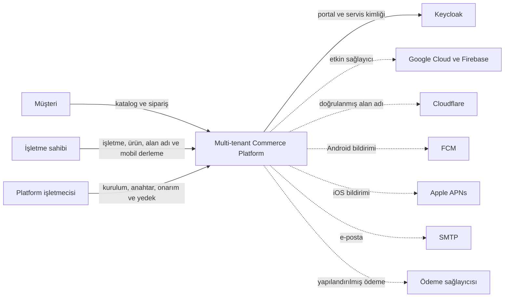
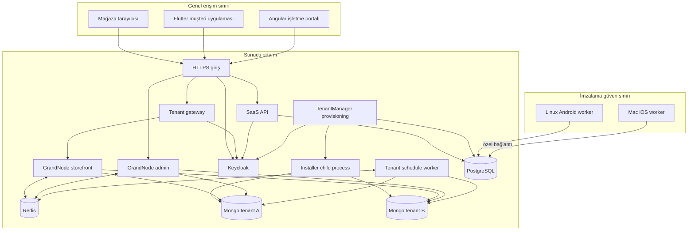
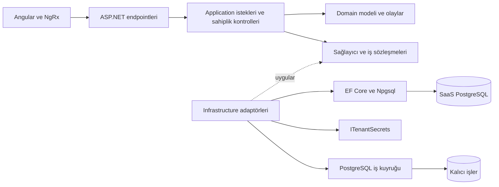
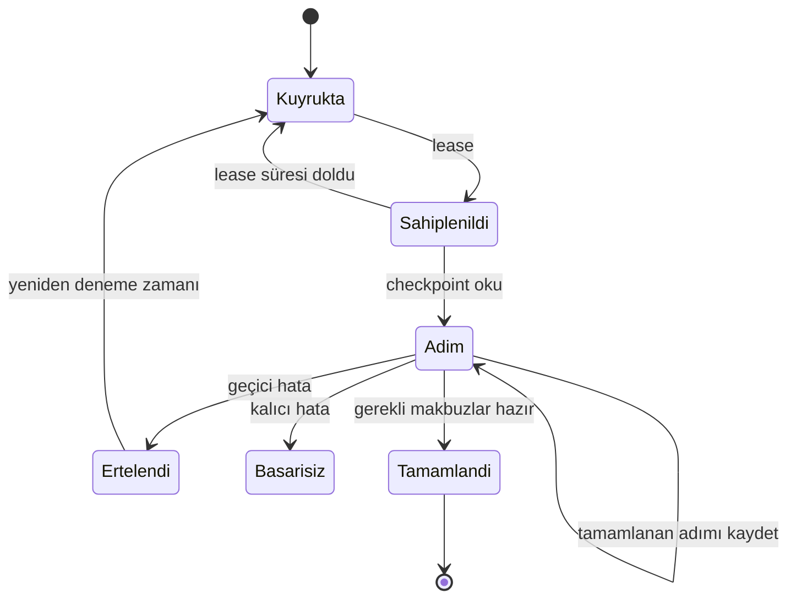
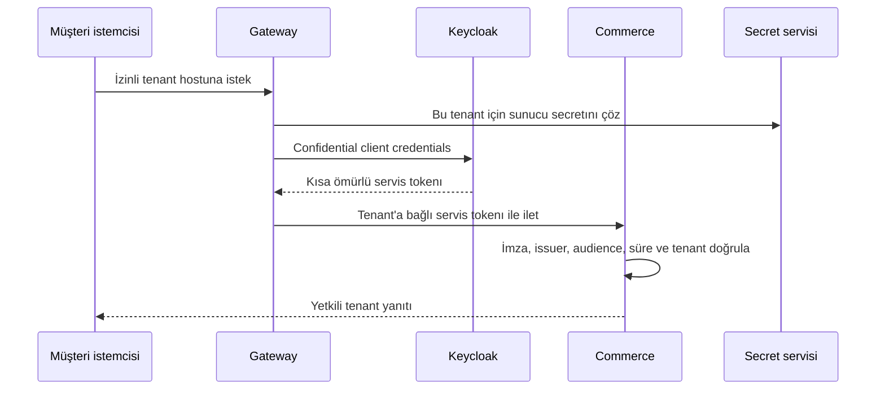
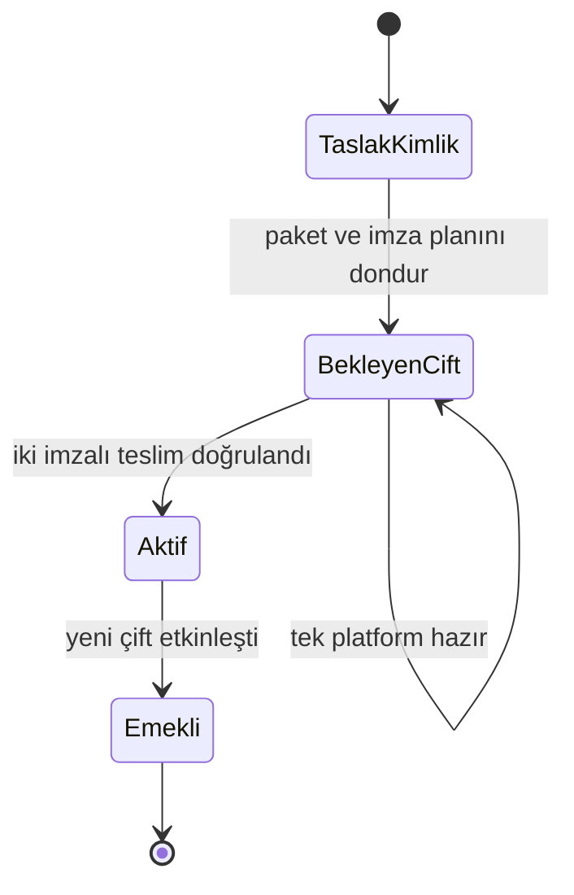

# Mimari: kayıt, tenant işletimi ve mobil teslim

Bu belge 18 Ekim 2026 tarihindeki uygulamayı geriye dönük açıklar. Gerekçe metinleri mevcut kodun teknik sonuçlarını anlatır; ölçülmemiş performans üstünlüğü veya geçmişte yapılmış bir mimari değerlendirme toplantısı iddiası değildir. [Karar kayıtları](decisions/README.md), [teknoloji tablosu](TECHNOLOGY.md) ve [doğrulama kayıtları](VALIDATION.md) birlikte okunmalıdır.

## 1. Sistem bağlamı

Keycloak işletmecinin kurduğu kimlik bileşenidir. Diğer dış servisler ayrı hesap/yetki ve açık yapılandırma gerektirir. Local demo gerçek bulut adımlarını yerel adaptörlerle sınırlar; dış sağlayıcıların varlığını simüle ederek canlı kabul iddiası üretmez.

## 2. Çalışan birimler ve veri sınırları

Şema mantıksal bir container görünümüdür; her ok herkese açık TCP portu anlamına gelmez. Veritabanları üretimde uygulama ağı içinde kalır. Mac çalışanın erişimi özel bağlantı ve ayrı kimlik/yetkiyle yapılandırılır. Yerel Python gateway ile üretim gateway/HTTPS girişinin işletim ayrıntıları aynı değildir; [gateway rehberi](GATEWAY.md) bunu ayırır.

| Veri | Esas saklama yeri | Sorumlu katman | Tutarlılık sınırı |
| --- | --- | --- | --- |
| İşletme, abonelik, portal modeli | SaaS PostgreSQL | EF Core `ApplicationDbContext` | İlgili DB transaction'ı |
| Katalog, müşteri, sepet, sipariş | Tenant MongoDB | GrandNode modülleri | Tenant ticaret işlemi |
| Secret değerleri | Şifreli PostgreSQL kayıtları | `Platform.Security` | Secret store transaction'ı; anahtar dışarıda |
| Kurulum/derleme sahipliği ve checkpoint | PostgreSQL | `Platform.Provisioning` | Lease/fencing ve kısa transactionlar |
| Alan adı / mobil kimlik / teslim geçmişi | Kalıcı kontrol kayıtları | SaaS + provisioning sözleşmeleri | İşlem aşaması ve makbuzlara göre uzlaşma |
| Geçici bildirim/cache olayları | Redis kanalları | Commerce/admin/task süreçleri | Kalıcı kurulum kuyruğu yerine geçmez |
| APK/IPA, sembol ve imzalama girdileri | Özel artifact/state dizinleri, dağıtım servisi | Platform çalışanları | Hash, imza ve teslim makbuzu |

Ayrı Mongo veritabanı uygulama hatasının etkisini daraltır; ortak process/DB sunucusu, yanlış secret yetkisi veya kaynak tüketimi riski devam eder. Her tenant için ayrı VM veya ayrı Mongo sunucusu kurulmaz. [ADR-001](decisions/0001-shared-runtime.md).

## 3. SaaS uygulamasının içi

`Domain`, `Application`, `Infrastructure`, `Web` ayrımı vardır. Bu, tüm iş kurallarının eksiksiz DDD modellemesiyle doğrulandığı veya tüm dış yan etkilerin event sourcing ile tutulduğu anlamına gelmez. DI, sağlayıcıları profil/config üzerinden bağlar. Mevcut Redis dinleyicileri/eski Azure yardımcıları korunur; Portable akışın doğruluk kaynağı kalıcı iş durumu ve completion reconciliation'dır.

Kaynak: [Infrastructure DI](../SaasManager/src/Infrastructure/DependencyInjection.cs), [Application](../SaasManager/src/Application), [Domain](../SaasManager/src/Domain), [ADR-002](decisions/0002-persistence.md), [ADR-005](decisions/0005-durable-work.md).

## 4. Tenant kurulumu

1. Doğrulanmış portal hesabı, kendi işletmesi adına kayıt isteği gönderir.
2. İşletme/abonelik/uygulama verisi kaydedilir ve kalıcı provisioning işi oluşur. Tamamlanma ayrı olarak uzlaştırılır.
3. Worker işi lease ile sahiplenir; heartbeat sürerken sıralı adımları çalıştırır.
4. Tenant DB/kullanıcı, installer, kimlik, yayın ve seçilmiş sağlayıcı adımları checkpointlerle ilerler.
5. Installer eklenti/ayar görevlerini tenant özelinde sırayla tamamlar. Doğru `BuildType` çıktısı şarttır.
6. Başarı ve hazır bilgisi kalıcı kayda yazılır; bağımsız tamamlayıcı portal durumunu günceller. E-posta kendi teslim/retry sınırına sahiptir.

Bu diyagram davranışın sadeleştirilmiş modelidir, enum adları değildir. Lease kaybeden worker yeni sonucu sahipmiş gibi yazamaz. Checkpoint dış API çağrısını transaction'a dönüştürmez; sağlayıcı adımları tekrar çağrılabilirlik ve mevcut kaynağı tanıma kurallarıyla çalışmalıdır. [Worker kaynağı](../Shared/Platform.Provisioning/ProvisioningWorker.cs), [kuyruk](../Shared/Platform.Provisioning/PostgresProvisioningQueue.cs), [onboarding](PROVISIONING.md).

Temel GrandNode kurulumu ayrıca doğrulanır: ana görevler, beş düzen türü, temel izinler ve hash'lenmiş sahip parolası tamamlanmadan Portable metadata başarı işareti almaz. `Settings.json` dosyasının bulunması tek başına tamamlanma kanıtı değildir. Eski kısmi kurulumlar, kimlikleri ve iş geçmişini koruyan açık bir operatör bakımıyla tamamlanır; işletme ayarları yeni bir süreçte yeniden uygulanır. [Kontrol ve onarım akışı](GRANDNODE_INSTALLATION_REPAIR.md).

## 5. BuildType ve eklenti ayrımı

GrandNode'un ticaret modülleri birden fazla host tarafından kullanılır. `Plugins` altındaki bütün eklentiler bütün build türlerinde bulunur; `Frontend` dışındaki türlerde `AdminPlugins` projeleri de derlenir. Build türü `BaseDir` ve dolayısıyla eklenti çıktı dizinini değiştirir. “Proje derlendi” sonucu, ilgili hostun doğru eklenti klasörüne sahip olduğunu tek başına kanıtlamaz.

Doğru publish doğrulaması; descriptor, assembly, bağımlılık ve static assetlerin hedef hostta bulunduğunu, Frontend çıktısına admin eklentisinin karışmadığını kontrol eder. Installer makbuzları olmadan tenant hazır sayılmaz. [Kurulum/BuildType rehberi](TENANT_INITIALIZATION.md), [eklenti aracı](../scripts/build_ecommerce_plugins.py), [ADR-006](decisions/0006-build-roles.md).

## 6. Kimlik, token ve secret erişimi

Bu servis tokenı, son kullanıcının müşteri hesabı oturumunun yerine geçmez. Mobildeki paket adı, host, app version veya device integrity kontrolü tek başına güvenilir istemci kimlik doğrulaması değildir. GrandNode müşteri/admin ve SaaS portal oturumlarının kendi kuralları vardır. Local admin GrandNode parola akışındadır; tüm admin rollerinin Keycloak SSO kullandığı iddia edilmez.

Secret sağlayıcısı DI ile seçilir. `PortableEncryptionService`, ortak Local AES-GCM zarfı/key davranışını kullanır; Portable etiketi başka algoritma veya otomatik anahtar göçü demek değildir. Azure ve yerel eski şifreli veriler birbirine sessizce çevrilmez. [Secret rehberi](TENANT_SECURITY.md), [ADR-003](decisions/0003-identity-boundaries.md), [ADR-004](decisions/0004-secret-providers.md).

## 7. Domain ve mobil kimlik geçişi

Domain seçimi ilk kayıtta veya sonra yapılabilir. API erişimi, tenant tahsisi, TXT sahiplik ispatı ve DNS çakışma kuralları ayrı kontrollerdir. Portal hesabının Cloudflare'de erişilebilen her domaini kendine atayabileceği varsayılmaz. Yeni domain storefront/admin route ve TLS adımlarından geçer; eski mağaza verisi yeniden seed edilmez.

Mobil paketler değişmez sürümlü kimliktir. Yeni paket istendiğinde aynı Firebase projesinde yeni Android/iOS app kayıtları açılır. Android sertifikaları ve iOS Team/profile/sertifika bağları paketle birlikte dondurulur. İşletme adı normalize edilir; çakışma/uygun karakter kuralları uygulama tarafından ele alınır. Domain değişikliği mevcut mağaza uygulamasının paketini yerinde dönüştürmez.

Yayımlanmamış iOS işinin kaynak özeti bozulduğunda operatör onarımı eski/yeni planı eklemeli geçmişte tutar; paket/sertifika/Firebase referanslarını sessizce değiştirmez. Mobil kaynak dönüşümü yeni plan/derleme gerektirir; eski imzalı artifacte yeni kaynak hash'i yakıştırılmaz. [Geçiş ve onarım](TENANT_DOMAINS_AND_MOBILE_IDENTITIES.md), [ADR-008](decisions/0008-versioned-identities.md).

## 8. Platform derlemeleri ve bildirim

Android Gradle Linux'ta; iOS Xcode Mac'te çalışır. Tenant flavor, Dart public defines, native AppIcon/launch screen, `flutter_launcher_icons` ve `flutter_native_splash` hazırlığı build girdisine bağlıdır. Secret ve imzalar public defines'a konmaz. Artifact hash'i, imza/paket/Firebase kimliği ve bağımsız teslim makbuzu birlikte doğrulanır. İki platformun aynı iş planında olması aynı işletim sisteminde derlenecekleri anlamına gelmez.

iOS doğrudan APNs, Android FCM kullanır. Apple push capability, Keychain distribution sertifikası, APNs auth key ve App Store Connect API anahtarı farklı amaçlara sahiptir. Team scoped APNs anahtarı birden çok tenant topic'i için kullanılabilir; her işletmeye ayrı anahtar yaratılması gerekmez. Firebase projesine APNs anahtarı yüklemek bu doğrudan iOS taşıma yolunun ön koşulu değildir.

Alıcı kaydı, doğrulanmış müşteri ve aktif mobil kimliğe bağlanır. Native APNs tokenı FCM tokenıymış gibi değerlendirilmez. Bildirimdeki route sınırsız URL çalıştırma izni değildir; tenant bağlantı kurallarına tabidir. Mevcut ilk kayıtta aynı token için iki satır oluşabilen yarış durumu vardır; sender tokenları tekilleştirir, admin satır sayısı cihaz sayısı sayılmaz. [Bildirim rehberi](MOBILE_NOTIFICATIONS.md), [ADR-009](decisions/0009-platform-builders.md), [ADR-010](decisions/0010-push-transport.md).

## 9. Tekrarlanan görevler ve Redis

Tenant provisioning ile periyodik görev yürütmesi farklı işlerdir. Ayrı schedule hostu tenant'ı sınırlı lease ile seçer ve görevleri o tenant bağlamında sıralı child process içinde yürütür. Web süreçlerinin aynı görevleri tekrar başlatmaması için bayraklar profilde açıkça ayrılır. Yapılandırılmamış dış entegrasyon, yalnız kaynakta var diye etkinleşmez.

Redis olayları, yönetim/mağaza/görev süreçleri arasındaki bildirim ve cache geçersizleştirmede kullanılır. Redis Pub/Sub kalıcı kuyruk değildir. Bir subscriber'ın çevrimdışı olduğu aralıkta teslim garantisi yoktur; kalıcı iş sonucu Postgres'ten uzlaştırılır. [Görev rehberi](TENANT_BACKGROUND_TASKS.md), [olaylar](DISTRIBUTED_NOTIFICATIONS.md), [cache](TENANT_CACHE.md), [ADR-011](decisions/0011-tenant-scheduling.md).

## 10. İşletim, kabul ve açık işler

Linux Compose ve OCI test yolu; yedek/anahtar/artifact sorumluluklarını işletmeciye bırakır. Bir VM'nin yeniden başlamasıyla containerların açılması; yedekten kurtarma, veri bütünlüğü, çok düğümlü HA veya yeni kaynak sürümünün kabulü demek değildir. Mac imza anahtarı Linux yedeğine dahil değildir. [SSH/Docker işletimi](ORACLE_SSH_DOCKER_DEPLOYMENT.md), [test/kaldırma](ORACLE_TEST_VE_KALDIRMA.md).

Yerel demo ve özel test sunucusunun kabul kayıtları [VALIDATION.md](VALIDATION.md) içindedir. Kaynak, artifact ve deployment sürümleri farklı olabilir; kayıtlar bunu belirtir. Görsel/tema değişiklikleri sonrası yeni native derleme ve fiziksel cihaz kabulü gerekir. Bu mimari yük ölçümü, PCI uyumu, ticari entegrasyon kabulü veya tüm bağımlılıkların güncel güvenlik onayı olarak sunulmaz.
