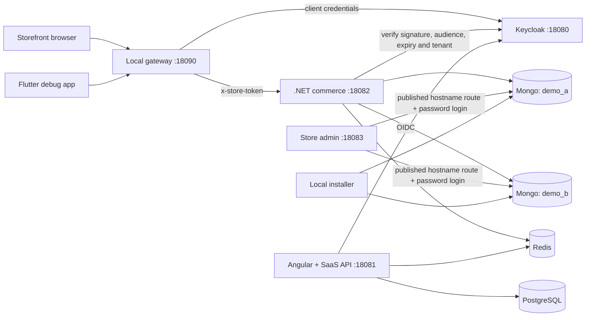
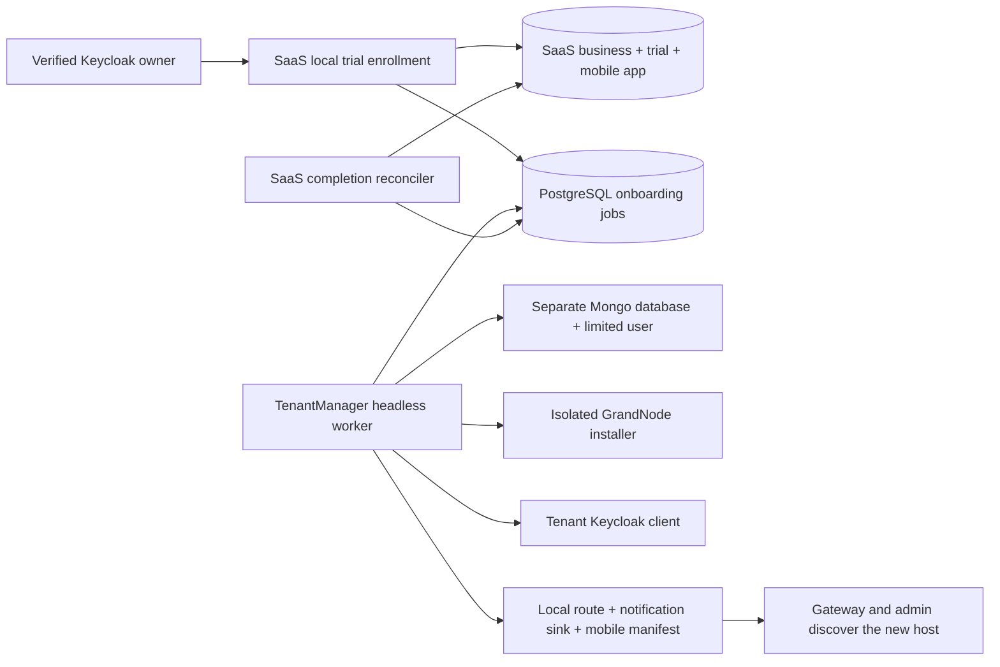

# Architecture

This is a source-only monorepo extracted into a separate directory. Original Git histories, credentials, generated plugins, customer catalogs and signing material are excluded. Existing project paths are retained to preserve references.

## Trust boundaries

The loopback gateway maps only known hosts to the two demo tenants. Keycloak service credentials stay on the host; browser and mobile bundles contain no confidential client secret. The commerce middleware still verifies issuer, audience, signature, expiration and tenant claims. Tenant store/database claims use the shared encryption contract. Local AES-GCM keys are derived from one explicitly provisioned deployment master key, allowing independent instances to decrypt the same tenant data.

The admin profile routes the two samples and newly published tenant hosts to their own databases, then relies on GrandNode's ordinary authenticated admin flow. The local adapters refuse to start outside `Development`. All exposed ports bind to `127.0.0.1`. HTTP and Keycloak `start-dev` are deliberate local-only choices.

Do not expose this profile to the internet. MongoDB requires authentication and each tenant user has read/write access only to its own database. Redis remains a loopback-only development service. Key material, generated credentials, runtime applications and logs live under ignored `.local/`.

## Cloud workflow retained as source

The original SaaS registration pipeline persists registration/subscription state and publishes Redis events. `TenantManager` consumes tenant/build events, orchestrates the installer, Azure deployment and Google/Firebase project/mobile build helpers. The installer creates the store database and identity metadata. Credential/build-completion events feed back into SaaS. The mobile builder supplies tenant-specific public configuration and signing/service configuration.

The local profile uses the shared PostgreSQL secret store and a Local encryption provider, and seeds two example tenants. The SaaS local enrollment page creates additional trial businesses; a headless TenantManager consumes PostgreSQL jobs and publishes their routes dynamically. See [tenant security](TENANT_SECURITY.md) for DI selection, registration, distributed access, Azure setup and migration boundaries. It does not invoke Azure deployment, Google/Firebase provisioning, DNS changes, payment providers, mobile signing or app-store publishing. The corresponding code is retained for a separate cloud profile, not presented as validated deployment instructions.

## Engineering changes in this extraction

- Environment-derived configuration and local-only adapters; no copied machine user-secret IDs.
- Server-side Keycloak service tokens and RSA/EC verification support.
- Expiry verification remains active for the query-token path.
- Real commerce installer creates synthetic products in separate databases.
- Angular demo configuration, local mail sink and disabled billing mutations.
- Flutter debug profile skips Firebase/device attestation requirements and removes insecure certificate acceptance.
- Mobile request logging excludes credentials and request/response bodies.
- Fresh Git repository; CodeGraph index remains untracked.

## Limits

The Python gateway does not proxy WebSockets and limits request bodies to 10 MiB. Push notifications, cloud storage, payment checkout, the cloud build queue and public-cloud provisioning are outside the local demo. Local trial enrollment and new tenant creation are covered by `scripts/smoke_onboarding.py`. Existing framework/dependency warnings remain; passing a smoke check is not a complete security audit or a production readiness assessment.

## Durable local onboarding

Credentials are resolved through `ITenantSecrets` at execution time. Neither job metadata nor public mobile defines contain passwords, database connections or confidential client secrets. SaaS completion is read from durable job state after restarts, rather than relying on Redis Pub/Sub delivery. Local trial session checks do not invoke the paid registration pipeline.
