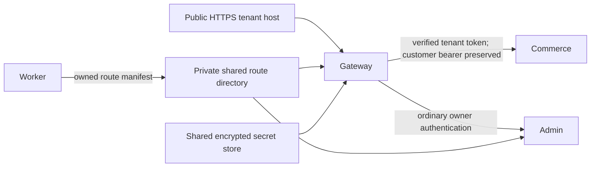

# Portable tenant gateway

`tools/Platform.Gateway` is an optional .NET 8 / YARP reverse proxy for the Portable worker profile. It serves owned tenant hosts from the worker's shared private route directory and reads existing tenant secrets from PostgreSQL through `Platform.Security`. It does not create or rotate encryption keys, clients or credentials. Azure is optional.



## Configuration and startup

Copy [gateway.example.json](../infra/portable/gateway.example.json), [commerce.example.json](../infra/portable/commerce.example.json) and [admin.example.json](../infra/portable/admin.example.json) into private deployment configuration. Replace the example domain origins and mount the same private route directory in the worker, gateway and admin. Use one existing master key and security database across these processes. Supply `PlatformSecurity__ConnectionString` privately. Gateway startup requires `ReadOnly=true` and `InitializeSchema=false`; initialize the shared schema with the deployment schema owner first.

Commerce/admin also require `Database__ConnectionString`, `Redis__RedisPubSubConnectionString` and `Redis__PersistKeysToRedisUrl`. These are private configuration values; never put them in tracked examples. The ordinary Mongo connection supplies bootstrap metadata; a verified commerce token or an owned admin route selects the actual tenant's separate connection before request services run. Tenant provisioning uses separate scoped Mongo users; unknown tenant hosts cannot select the bootstrap database. Full fresh-production bootstrap/deployment orchestration is still being completed.

Publish the gateway and the existing commerce/admin projects in Release. Set `ASPNETCORE_ENVIRONMENT=Production`, `DOTNET_ENVIRONMENT=Production`, and `Gateway__ConfigPath` / `PlatformConfiguration__ConfigPath` to the respective absolute private config file. Environment values override the config file. For the gateway use either a Kestrel HTTPS endpoint with a certificate/private key supplied through deployment secrets or a separately configured trusted TLS terminator. `Gateway:IdentityAuthority` is the HTTPS origin without `/realms/...`; commerce `AuthConfiguration:IdentityProviderUrl` is the complete realm issuer URL. An explicit private CA can be configured using `Gateway:IdentityRootCertificateFile` and commerce `AuthConfiguration:AuthorityRootCertificateFile`; ordinary public roots work without those settings. TLS chain and hostname verification remain enabled.

The examples describe a single host with loopback commerce/admin upstreams on ports 18182/18183. Bind backend listeners to loopback using `ASPNETCORE_URLS`. Set the gateway's HTTPS listener separately. `AllowHttpUpstreams=true` is explicit for this private hop; use HTTPS upstreams (and optional `Gateway:UpstreamRootCertificateFile`) when crossing a network requiring TLS. Only the gateway/public edge should be publicly reachable. The gateway does not expose SaaS management on tenant hosts; deploy the separate SaaS origin using [SAAS_PROVIDERS.md](SAAS_PROVIDERS.md).

## Proxy and tenant boundaries

`Proxy:Enabled=true` requires explicit literal `KnownProxies` or bounded CIDR `KnownNetworks`, plus a `ForwardLimit` from 1 to 10. The examples trust only the loopback gateway at the private backends. Set the real gateway/edge peer addresses for your deployment; an empty trust list or `/0` network is refused. Only the client IP and scheme are processed. Public Host values remain subject to explicit configured parent domains and ports. Applying the shared middleware twice cannot consume additional forwarding hops. The old automatic scheme override based on raw Azure headers or `LOCAL_DOCKER_ID` is removed. Azure TLS termination can use the same explicit trust configuration; `WEBSITE_HOSTNAME` alone no longer changes listener ports or trusts request headers.

The gateway strips caller-supplied tenant tokens, `store_token` query parameters and forwarding/internal tenant headers. It obtains the confidential tenant service token on the server, forwards it only to commerce and preserves the customer's independent bearer token. Fetches are shared per canonical tenant/slug and cached within the issuer lifetime and configured bounds. Upstream destinations come exclusively from fixed deployment configuration. Manifests cannot choose a destination URL. Ordinary commerce JWT verification and admin authentication remain active. Internal token/Authorization response headers are removed; cookie, byte-range and streaming/WebSocket behavior is handled by YARP.

Unknown hosts, wrong public ports, Local/foreign manifests, alias ownership conflicts and symlink/oversized metadata files fail closed. Store/admin origins and canonical tenant ids must match the deployment. The optional loopback `/_gateway/health` checks gateway liveness only. The worker's public `/_platform/ready` probe verifies the actual store database; it separately requires the owned HTTPS admin redirect/login before declaring the tenant ready.

## Customer token login

`TenantTokenWeb/login` and the legacy `TokenWeb/login` preserve the mobile JSON contract: `Email` and a UTF-8 Base64 `Password`, sent over HTTPS. Base64 supplies encoding only. Syntax validation rejects malformed/invalid UTF-8 values with HTTP 400. The action boundary independently loads the customer from the selected tenant database, checks account eligibility/lock status, invokes the ordinary password verifier and requires successful authentication before creating refresh/access tokens. Failed authentication returns a generic 401. Two-factor-pending accounts do not receive a password-only token. Existing MVC validation previously performed the password check; it now supplies syntax validation while the shared action boundary owns authentication. Flutter encodes the password as UTF-8, including Turkish and other Unicode characters.

## Reproducible verification and limits

```sh
dotnet test tests/Gateway.Tests/Gateway.Tests.csproj -c Release
python3 scripts/demo.py up
python3 scripts/smoke_portable_deployment.py
python3 scripts/demo.py stop
```

The probe publishes the gateway and starts the actual Production commerce, admin and headless worker against uniquely owned PostgreSQL/Mongo fixture namespaces and an isolated HTTPS Keycloak with a scoped provisioner. A loopback-only CONNECT fixture maps synthetic `.example.test` names to the real gateway. TLS remains end to end with a generated private CA and wildcard leaf; it does not modify the hosts file, disable validation or call a DNS API. The ordinary demo's bootstrap metadata and Redis are reused. Two fresh tenants are installed without gateway restarts, and the probe exercises owner password login, customer session refresh, cross-tenant credentials/cookies/database denial and an admin process restart. Backend applications, temporary identity resources and uniquely owned fixture databases/users are stopped/removed; persistent demo data is retained.

This proves local Production-mode runtime behavior. It does not prove a public DNS account, real external TLS/ingress, a fresh production infrastructure rollout, Production SaaS enrollment/paid billing, real Google/device delivery or automatic signed mobile distribution. Those remain acceptance gates in [PROVISIONING.md](PROVISIONING.md). The updated remote CI must also be run against the published branch before claiming clean-clone CI success.
