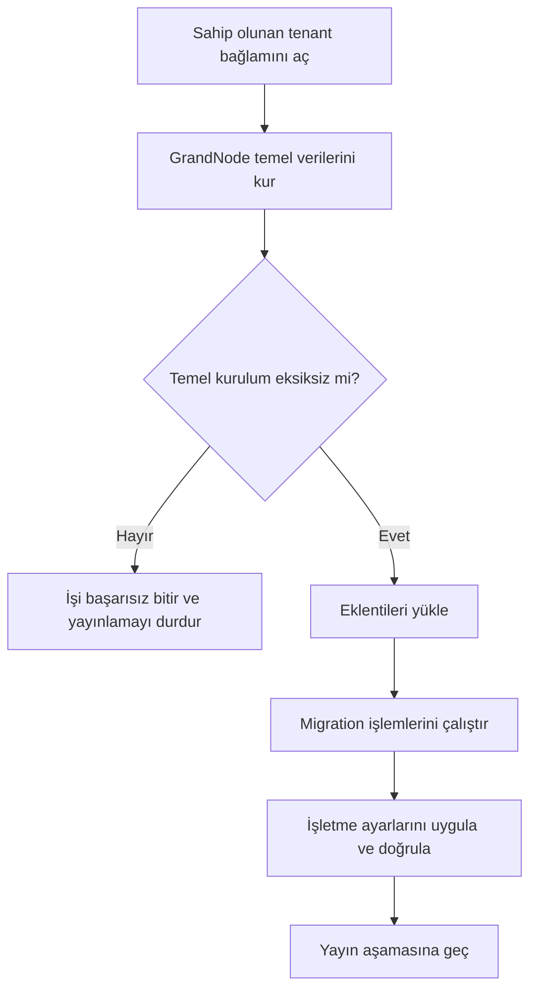

# Yarım kalan GrandNode kurulumunu tamamlama

Mağaza belgesi veya başarılı provisioning işi tek başına GrandNode kurulumunun tamamlandığını göstermez. Temel kurulum; varsayılan ayarları, çevirileri, sahibi için parola hash'ini, sayfa/katalog düzenlerini, temel izinleri ve ana zamanlanmış görevleri de oluşturmalıdır. Eklenti kurulumu, migration ve işletme ayarları bunun ardından çalışır.

## Hatanın nedeni ve düzeltme

CLI, veritabanı kurulumundan önce tenant bağlamını başlatmıyordu. Kurulumun ön bölümü verileri yazdıktan sonra tenant kapsamındaki önbellek erişimi başarısız olabiliyordu. `Settings.json` dosyasının varlığı sonraki denemede kurulumu erken bitiriyor; eklenti ve işletme aşamaları eksik temel veriler üzerinde ilerleyebiliyordu.

Yönetilen kurulum artık ilk önbellek erişiminden önce sahip olunan tenant kimliğiyle başlar; mağaza oluşturulduktan sonra gerçek `Store.Id` kapsamına geçer. Portable metadata yalnız temel kurulum kontrolü geçince `baseInstallationVerified: true` alır. Kontrol; sağlayıcının bütün temel izinlerini, beş düzen koleksiyonunu, hash'lenmiş sahip parolasını ve yedi ana görev türünü gerektirir. İzin eylemleri `Permission.Actions` içinde saklanır; ayrı `PermissionAction` koleksiyonunun varlığı beklenmez.

Çeviri kurulumu aynı dil ve anahtar için yalnız eksik kaynakları ekler; mevcut çeviriyi değiştirmez. Yeni çeviri kimliği açıkça string olarak üretilir. Sayfa, düzen ve görev ekleme işlemleri mevcut sistem adı, görünüm yolu veya görev türünü yeniden eklemez.



## Mevcut işletme için kontrollü onarım

Bu bakım modu mevcut ve `Succeeded` durumundaki Portable işe uygulanır. İşin tenant kimliği, dağıtım hedefi, secret sahipliği ve mağaza metadata/checkpoint eşleşmesi doğrulanır. Kuyruk tüketicisi başlamaz; cloud kaynakları yeniden oluşturulmaz. İşin geçmiş request ve step kayıtları korunur. Tamamlanmış görev makbuzları yeniden kullanılabilir; son kabul kontrolleri ayrıca çalıştırılır. Başarısız veya bekleyen işler için önce özel installer günlüğünü inceleyin ve normal kuyruk yeniden deneme yolunu kullanın. Kısmi temel veriler yüzünden tamamlanma kontrolü yine başarısız olursa operatör incelemesi gerekir; bu bakım modu eksik mağaza/checkpoint üretmez.

Onarım temel varsayılan ayarları tekrar uygular ve ardından yönetilen işletme ayarlarını yeniden çalıştırır. Üzerinde özel ayar değişikliği yapılmış bir işletmede önce bu ayarların yedeğini ve etkisini inceleyin. Ürünler, siparişler, mağaza/müşteri kimlikleri veya Firebase/imzalama kimlikleri sıfırlanmaz. Hash'lenmiş sahip parolası değiştirilmez; yarım kurulumdaki hash'lenmemiş parola tamamlanır.

1. Düzeltilmiş commit'ten derlenmiş worker/installer imajını kullanın. Eski imaj yeni bakım seçeneğini içermez.
2. [Tutarlı snapshot](BACKUP_RESTORE.md) alın, VM dışında doğrulayın ve özgün imajları saklayın. Bu işlem geri yükleme planının yerini almaz.
3. Aynı kurulumun provisioning ve görev işçilerini durdurun. Veritabanı onarımı boyunca mağaza/yönetim servislerini de durdurun; diğer hostlardaki yazıcılar varsa onları da koordine edin.
4. Aşağıdaki bakım komutunu her tenant için sırayla çalıştırın. Komut başarısız olursa özel installer günlüğünü incelemeden sonraki aşamaya geçmeyin.
5. İzinleri, görevleri, düzenleri ve gerçek mağaza/yönetim girişini kontrol edin; bekleyen e-posta kuyruğunu inceleyip servisleri başlatın.

Linux sunucuda, kendi gerçek private state yolunuzu ve 32 karakterli tenant GUID'nizi kullanın:

```sh
STATE=/absolute/private/production-state
TENANT=0123456789abcdef0123456789abcdef
COMPOSE_PROJECT=$(python3 -c 'import json,sys; print(json.load(open(sys.argv[1]))["name"])' "$STATE/compose.json")
dc() { docker compose --project-name "$COMPOSE_PROJECT" --file "$STATE/compose.json" "$@"; }

dc stop worker task-worker commerce admin
dc run --rm --no-deps \
  -e "Provisioning__ReconcileTenant=$TENANT" \
  -e Provisioning__RepairBaseInstallation=true \
  worker worker
```

`task-worker` servisi bu dağıtımda yapılandırılmış olmalıdır; devre dışı bir dağıtımda bu servis adını durdurma/başlatma komutlarından çıkarın. Tenant kimliği mağazanın `Store.Id` alanıyla aynı olmak zorunda değildir; provisioning işindeki canonical tenant kimliğini kullanın.

Kontrol tamamlandıktan sonra:

```sh
dc start commerce admin worker task-worker
```

İşletmenin çalışma klasöründeki `tenant-base-repair.log` alt sürecin özel günlüğüdür. Önceki temel metadata ve işletme ayar makbuzu `.before-base-repair.<guid>` ekli dosyalarda korunur; yönetilen ayarlar yeni bir CLI sürecinde yeniden yüklenir. Bu dosyaları ve veritabanı yedeklerini Git'e veya herkese açık hata raporuna eklemeyin.

## Kabul kontrolü

- Mağaza ana sayfası HTTP 200 döner; istenmeden giriş sayfasına yönlenmez.
- İşletme sahibi mağaza hesabına ve yönetim paneline gerçek parolasıyla giriş yapabilir.
- Temel izinler ve `Permission.Actions` yüklenmiştir; ürün listesi CSS/JS dosyaları doğru içerik türüyle açılır.
- Beş temel düzen türü, %1/%10/%20 vergi kategorileri, vergi sağlayıcıları ve mobil adres alanları bulunur. Yeni işletmede mağaza ve kur hesaplama para birimi TRY olur. Mevcut işletmedeki açıkça onaylanmış farklı seçim ayrıca korunur; kontrol aracı private fixture içinde `expectedPrimaryStoreCurrency` ve `expectedPrimaryExchangeRateCurrency` alanlarını ayrı ayrı kabul eder. Bu alanlar veritabanını değiştirmez; ikisi de verilmezse beklenen değer TRY olur.
- Seçili bu dağıtımda yedi ana görev ve yedi eklenti/önbellek görevi toplam 14 kayıt oluşturur; 10'u açık, 4'ü kapalıdır. Farklı eklenti seçimi toplamı değiştirebilir. Kapalı görevler sırf test için açılmaz.
- Ayrı görev servisi seçilen tenant'lar için çalışır; açık görevlerin yürütme kayıtları izlenir. Servisin tenant izin listesine dahil olmayan bir işletme için çalışması beklenmez. Bu sürümde yeni kurulum 13 görev / 9 açık kayıtla başlar; [`ManagedScheduledTasks`](../Ecommerce/src/Installer/Grand.Installer.Cli/Services/ManagedScheduledTasks.cs) ilk yürütmede eksik mobil önbellek bildirim görevini ekleyince 14 / 10 olur.
- Onarım öncesindeki mağaza/müşteri kimlikleri, provisioning request/checkpoint'leri, mobil paketler ve imzalama ilişkileri korunur.

Güncel canlı testin kapsamı ve sınırları [doğrulama kaydında](validation/oracle-clean-install-20261018.json) yer alır.
