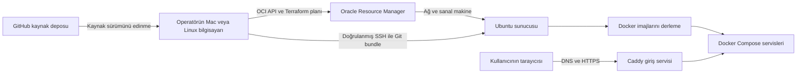
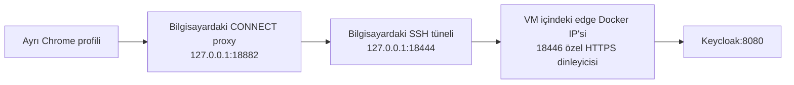

# Oracle üzerinde SSH ve Docker ile dağıtım

Bu projede dağıtımı operatörün Mac veya Linux bilgisayarı başlatır. Oracle Resource Manager, Terraform tarifinden Linux sunucusunu oluşturur. Operatör, commit edilmiş kaynak kodunu doğrulanmış SSH bağlantısıyla bu sunucuya gönderir. Sunucu Docker imajlarını derler ve uygulamaları Docker Compose ile çalıştırır.

GitHub kaynak kodunun saklandığı yerdir. Bu akış GitHub Actions kotası, GitHub Container Registry veya ayrı bir bulut derleme sunucusu gerektirmez. Aşağıdaki işlemler mevcut operatör aracının yaptığı işleri ve aynı kurulumu kendi hesabınızda nasıl tekrarlayacağınızı açıklar. Hesap ve kaynak seçimi için [Oracle kurulum rehberini](ORACLE_DEPLOYMENT.md), uygulama girdileri için [Linux Production rehberini](LINUX_PRODUCTION.md) birlikte kullanın.

## İşlemler nerede çalışıyor



| İşlem | Çalıştığı yer | Sorumlu dosya |
| --- | --- | --- |
| Oracle kimlik doğrulaması, plan, apply ve SSH dağıtımı | Operatör bilgisayarı | [scripts/oracle.py](../scripts/oracle.py) |
| Sunucu, ağ, disk ve test durdurma kuralının tarifi | Oracle Resource Manager | [infra/oracle](../infra/oracle/) |
| Docker ve işletim sistemi araçlarının ilk kurulumu | Ubuntu ilk açılışı | [cloud-init.yaml](../infra/oracle/cloud-init.yaml) |
| Git bundle alma ve doğru commit dizinini hazırlama | Ubuntu, `ubuntu` kullanıcısı | [oracle_remote.py](../scripts/oracle_remote.py) |
| Özel yapılandırma üretme ve servisleri başlatma | Ubuntu, `ubuntu` kullanıcısı | [production.py](../scripts/production.py), [production_config.py](../scripts/production_config.py) |
| Uygulama imajını temiz Git sürümünden derleme | Sunucudaki Docker | [production_image.py](../scripts/production_image.py), [Dockerfile](../infra/production/Dockerfile) |
| Veritabanı ve özel durumun tutarlı yedeğini alma | Ubuntu | [production_backup.py](../scripts/production_backup.py) |

## Birinci aşama Oracle sunucusunun oluşturulması

Operatörün OCI CLI profili kendi Oracle kullanıcısı, API anahtarı ve tenancy bilgileriyle yapılandırılır. API private key ve profil dosyası operatör bilgisayarında, Git dışında kalır. Sunucuya GitHub token veya OCI API anahtarı kopyalanmaz.

`operator.json` dosyası yalnızca bölge, compartment, availability domain, sabit Ubuntu imajı, deployment adı, SSH public key ve SSH için izin verilen operatör IPv4 adresini içerir. Kredi testinde ayrıca kaynak profili ve kesin UTC durdurma saati vardır. Bu dosyada uygulama parolaları bulunmaz.

Operatör aracı Resource Manager için yalnızca şu dört dosyayı paketler:

```text
main.tf
credit.tf
cloud-init.yaml
.terraform.lock.hcl
```

Terraform şablonu tek VM, VCN, subnet, internet gateway, route table ve security list oluşturur. Kredi profili bunlara izole bir compartment, VM durdurma zamanlayıcısı ve sadece o zamanlayıcıya ait dar kapsamlı politika ekler. Load balancer, NAT gateway ve Kubernetes bu kurulumun parçası değildir.

Varsayılan `always-free-arm` profili A1 üzerinde 2 OCPU ve 12 GB RAM kullanır. Açıkça seçilen `credit-minimal-amd64` test profili E5 üzerinde 1 OCPU, 8 GB RAM ve 100 GB boot disk kullanır. Ücretli profile otomatik geçiş yapılmaz. Kredi testinin durdurma saati en fazla altı saat ileride seçilir; tekrar çalıştırma bu saati uzatmaz. Boyut ve maliyet koşulları [Oracle rehberinde](ORACLE_DEPLOYMENT.md) açıklanır.

İlk hazırlığın ardından aşağıdaki çağrılar operatör bilgisayarında çalışır. Örneklerde OCI profilinin `COMMERCE`, özel dosyaların `.local/oracle/` altında olduğu varsayılır:

```sh
python3 scripts/oracle.py package \
  --variables .local/oracle/operator.json --state .local/oracle/state

python3 scripts/oracle.py plan \
  --variables .local/oracle/operator.json --state .local/oracle/state \
  --oci-config .local/oracle/config --profile COMMERCE
```

`package` buluta bağlanmaz. `plan` bir Resource Manager stack ve plan işi oluşturur; VM oluşturmaz. Operatör planı inceleyip yalnızca beklediği kaynakları içerdiğini gördükten sonra çıktıda verilen gerçek plan kimliğini uygular:

```sh
python3 scripts/oracle.py apply \
  --variables .local/oracle/operator.json --state .local/oracle/state \
  --oci-config .local/oracle/config --profile COMMERCE \
  --reviewed-plan ocid1.ormjob.REPLACE_WITH_REVIEWED_PLAN \
  --trial-credit-use-confirmed
```

Bu son örnek kredi profiline aittir. Ücretsiz profilde bunun yerine `--always-free-budget-confirmed` kullanılır. Sonuçtaki VM kimliği, genel IP, stack ve iş kimlikleri özel state dizinine kaydedilir. Aynı komut kaydedilmiş işi devam ettirir; belirsiz bir oluşturma çağrısı körlemesine tekrarlanmaz.

## İkinci aşama Ubuntu ilk açılışı ve SSH güveni

Oracle, VM açılırken `cloud-init.yaml` dosyasını çalıştırır. Bu dosya Ubuntu paketlerinden Docker, Docker Buildx, Docker Compose, Git, Python ve OpenSSL'i kurar; Docker servisini açar ve `ubuntu` kullanıcısını Docker grubuna ekler. HTTP ve HTTPS için işletim sistemi firewall kuralını kalıcı bir systemd servisiyle hazırlar. Parolayla SSH ve root SSH erişimi kapalıdır.

SSH yalnızca operatör girdisindeki genel IPv4 `/32` adresine açıktır. HTTP 80 ve HTTPS 443 dışarıya açıktır. PostgreSQL, MongoDB, Redis ve Keycloak'un iç HTTP portları internete yayımlanmaz.

İlk SSH bağlantısından önce sunucunun Ed25519 host key kimliği Oracle'ın doğrulanmış console kaydından veya instance console bağlantısından doğrulanır. Ağdan gelen `ssh-keyscan` sonucunu tek başına güvenilir kabul etmek yeterli değildir. Console history içeriği CLI'de varsayılan olarak ilk 10 KB ile sınırlı gelebilir; ilk açılış anahtarlarını okumak için `get-content --length 1048576` kullanılabilir.

Doğrulanan anahtar özel `known_hosts` dosyasına yazılır. Dağıtım aracı şu koşullarla SSH açar:

- `StrictHostKeyChecking=yes` ile sunucu kimliğini kontrol eder.
- Yalnızca açıkça verilen SSH private key ve `known_hosts` dosyasını kullanır.
- Parola sormadan çalışır ve SSH agent forwarding yapmaz.
- Sunucuda root yerine `ubuntu` kullanıcısıyla uygulama işlemlerini yürütür.

Özel anahtar dosyaları `0600`, özel dizinler `0700` olmalıdır. SSH public key Terraform'a girer; SSH private key operatör bilgisayarında kalır.

## Üçüncü aşama alan adı HTTPS ve özel girdiler

Operatör portal, identity ve tenant wildcard DNS kayıtlarını VM'nin IP adresine yönlendirir. Örnek adlar şöyledir:

```text
portal.example.com
identity.example.com
*.shops.example.com
*.manage.example.com
```

Bu çalışmadaki HTTPS sertifikası operatör bilgisayarında Certbot ve Cloudflare DNS doğrulamasıyla alındı. Geçici TXT doğrulama kayıtlarını Certbot oluşturup kaldırdı. Cloudflare token bu işlem için operatör bilgisayarında kaldı. Uygulamanın tenant adları wildcard DNS üzerinden çözüldüğü için her işletme için ayrıca Cloudflare kaydı açılması gerekmez.

Ücretsiz Cloudflare full-zone sertifikası derin tenant adlarını otomatik kapsamaz. Bu dağıtımda DNS-only kayıtlar ve tarayıcıların güvendiği, gerekli wildcard adlarını kapsayan origin sertifikası kullanılır. Sertifikanın süresi dolmadan yenilenmesi işletmecinin sorumluluğundadır.

Operatör sertifika, uygulama deployment girdisi ve seçtiği sağlayıcıların kimlik dosyalarını doğrulanmış SSH/SCP üzerinden ayrı olarak taşır. Bunlar kaynak bundle içine girmez:

```text
/home/ubuntu/commerce-DEPLOYMENT_ID/inputs/
  deployment.json
  fullchain.pem
  privkey.pem
  google-provisioning.json       Google açıksa
  google-notifications.json     FCM açıksa
  apns-key.p8                   Doğrudan APNs açıksa
```

`deployment.json` içindeki dosya yolları sunucudaki mutlak yollardır. Google proje oluşturan hesabın dosyası yalnızca worker servisine bağlanır. Ayrı FCM gönderici hesabı mağaza ve yönetim servislerine bağlanır. APNs anahtarı sadece bildirim gönderen uygulama servislerine verilir. Apple imzalama ve App Store Connect private anahtarları Linux sunucusunun bu web girdilerine dahil değildir.

## Dördüncü aşama kaynak kodunun SSH ile taşınması

Operatör dağıtacağı kaynakları önce commit eder. Sonra aşağıdaki komutu yine kendi bilgisayarında çalıştırır:

```sh
python3 scripts/oracle.py deploy \
  --variables .local/oracle/operator.json --state .local/oracle/state \
  --oci-config .local/oracle/config --profile COMMERCE \
  --identity .local/oracle/deploy-key \
  --known-hosts .local/oracle/known_hosts
```

`oracle.py` önce kayıtlı stack, başarılı apply sonucu ve kredi profilinde gerçek durdurma kuralını doğrular. Git'ten mevcut `HEAD` commit kimliğini alır. `git bundle create ... HEAD` ile bu commit'i ve eriştiği Git geçmişini tek dosyada paketler. Çalışma dizinindeki commit edilmemiş değişiklikler, ignored `.local` dosyaları ve yerel `.git/config` bu pakette bulunmaz.

Araç, receiver programını da aynı commit'ten `git show` ile okur. Doğrulanmış SSH bağlantısında bu programı çalıştırır ve bundle'ı standart giriş üzerinden gönderir. Sunucunun GitHub'a bağlanmasına veya GitHub kimlik bilgisi almasına gerek kalmaz.

Receiver daha önce oluşturduğu kurulum sahiplik kaydını, özel dizinleri ve deployment adını kontrol eder. Aynı kurulumda eşzamanlı iki dağıtımı kilitle engeller. Gönderilen commit için ayrı bir kaynak dizini oluşturup doğru commit'i checkout eder. Mevcut kaynak dizini elle değiştirilmişse onu sessizce kabul etmez.

Sunucudaki kalıcı düzen şöyledir:

```text
/home/ubuntu/commerce-DEPLOYMENT_ID/
  inputs/                    Operatörün özel girdileri
  oracle-installation.json   Receiver sahiplik kaydı
  deploy.lock                Aynı sunucudaki dağıtım kilidi
  deploy.log                 Uygulama kurulumunun özel çıktısı
  sources/
    COMMIT_SHA/              Commit'e ait temiz kaynak dizini
  state/                     Anahtarlar ve kalıcı uygulama durumu
  last-successful-revision   HTTPS kontrolleri geçen son commit
```

## Beşinci aşama sunucuda Docker derlemesi

Receiver, kaynak dizinindeki `production.py up` komutunu özel deployment girdisi ve aynı kalıcı `state/` diziniyle çalıştırır. Uygulama imajı eksikse `production_image.py`, sunucudaki commit'i `git archive` ile temiz derleme girdisine dönüştürür ve Docker'a verir.

Dockerfile birden çok derleme aşaması kullanır. .NET 8 tarafında mağaza, yönetim uygulaması, installer, gateway ve cloud aracı; .NET 9 tarafında SaaS, tenant worker ve bootstrap aracı derlenir. SaaS'ın gerçek Angular arayüzü de bu işlemde hazırlanır. Son runtime imajı .NET 8 ve .NET 9 çalışma ortamlarını içerir ve sunucudaki dağıtım hesabının sayısal UID/GID'siyle root olmadan çalışır.

İmaj `commerce-platform:COMMIT_KISA_KIMLIGI` adıyla sunucuda tutulur. İçindeki `org.opencontainers.image.revision` etiketi tam commit kimliğini taşır. Başlatma aracı bu etiketin kaynak commit'i ve imaj kullanıcısının operatör hesabıyla eşleşmesini kontrol eder. Çalışma zamanı kimlik dosyaları Docker derleme girdisine eklenmez; servisler başlatılırken ayrı, salt okunur bağlarla verilir.

## Altıncı aşama Compose servislerinin açılması

`production_config.py` özel `state/` altında Compose tanımını, servis yapılandırmalarını, Caddy ayarını, Keycloak realm girdisini ve gerekli anahtarları hazırlar. İlk kurulum kaydı anahtarları bir kez üretir. Sonraki çalıştırmalar aynı kaydı kullanır; mevcut ortak şifreleme anahtarı ve parolalar otomatik yenilenmez.

Başlatma sırası şöyledir:

1. PostgreSQL, MongoDB ve Redis açılır; hazır olmaları beklenir.
2. Kurulum sahipliği kontrol edilerek veritabanları ve sınırlı uygulama hesapları hazırlanır.
3. Bootstrap aracı uygulama şemalarını ve deneme planını hazırlar.
4. Keycloak açılır; tenant-provisioner istemcisinin gerçek kimlik doğrulaması sınanır.
5. Yapılandırılmış kullanıcı kaydı ve SMTP politikası mevcut realm'e uygulanır.
6. SaaS, mağaza, yönetim, gateway, worker ve Caddy açılır.
7. Gerçek HTTPS üzerinden portal, identity metadata ve bilinmeyen tenant reddi kontrol edilir.

Sadece konteynerin çalışıyor olması dağıtımı başarılı saydırmaz. Receiver `last-successful-revision` kaydını ancak mevcut uygulama ve HTTPS kontrolleri geçtiğinde yazar.

| Servis | Görevi |
| --- | --- |
| `edge` | Caddy ile HTTPS sonlandırma ve doğru uygulamaya yönlendirme |
| `saas` | İşletme sahibinin portalı ve kayıt işlemleri |
| `keycloak` | Kullanıcı girişi, e-posta doğrulaması ve istemci token'ları |
| `gateway` | Tenant adına göre mağaza veya yönetim servisine yönlendirme |
| `commerce` ve `admin` | Tenant mağazası ve yönetim uygulaması |
| `worker` | Kuyruktan tenant kurulumu ve seçilmiş dış sağlayıcı adımları |
| `postgres` | SaaS, identity, şifrelenmiş tenant secret'ları ve iş kuyruğu |
| `mongo` | Tenant mağazalarının ayrı veritabanları |
| `redis` | Önbellek ve uygulama içi olay iletişimi |

Tenant secret'ları ortak AesGcm sağlayıcısı ve özel PostgreSQL deposuyla kullanılır. Dağıtık servisler aynı korunan master key'e erişir; mağaza ve yönetim için okuma hesabı, worker için gerekli yazma hesabı verilir. Yedekte şifreli veritabanı ile ilgili master key birlikte korunmalıdır.

## Küçük sunucuda Android derleme ayarı

Android mobil profili seçildiğinde Production hazırlığı `state/mobile-cache/gradle/gradle.properties` dosyasını ilk kullanımda özel izinlerle oluşturur. Varsayılan Gradle heap sınırı 2 GB, metaspace sınırı 512 MB ve paralel işçi sayısı birdir. Kotlin derleyicisi aynı Gradle sürecinde çalışır; ayrı bir compiler daemon başlatılmaz. Bu sınırlar diğer uygulama servislerine alan bırakmak içindir; tüm sunucunun toplam RAM kullanımına konulan bir limit değildir.

Gradle kullanıcı dizinindeki bu dosya proje içindeki iş istasyonu ayarlarından önceliklidir. `Platforms/store_user_app/android/gradle.properties` ve mobil kaynağın hash değeri değiştirilmez. Operatör mevcut özel cache dosyasını düzenlediyse `prepare` sonraki dağıtımda onun üzerine yazmaz. Dosya sahibi, izinleri ve sembolik bağlantılar kontrol edilir. Cache diskte tutulur; imza anahtarları ve değişmez APK çıktıları ayrı kalıcı alanlarda korunur.

Gradle öncelik sırası [resmî Gradle belgesinde](https://docs.gradle.org/current/userguide/build_environment.html), Kotlin süreç seçimi [resmî Kotlin belgesinde](https://kotlinlang.org/docs/gradle-compilation-and-caches.html#defining-kotlin-compiler-execution-strategy) açıklanır. Android SDK lisansları ve imza/kalıcı artifact seçenekleri açıkça seçilmeden mobil profil etkinleşmez.

## Kullanıcının isteği sunucuda nasıl ilerliyor

Tarayıcı portalı HTTPS ile açınca Caddy isteği SaaS'a iletir. Giriş gerektiğinde SaaS, kullanıcıyı Keycloak'a yönlendirir. Kimlik servisi tarayıcıya açık HTTPS adresini kullanır; uygulamalar arasındaki kimlik çağrıları standart 443 kurulumunda Docker ağındaki özel edge IP'sine gider. TLS adı ve token issuer aynı kalır.

Bu özel yönlendirme önemlidir: Oracle VM kendi public IP'sine geri dönerken kaynak adresi değişebilir. Keycloak yönetim yoluna böyle gidilirse özel ağ kontrolü 404 döndürebilir. Compose'un `extra_hosts` ayarı bunu sunucu içinde çözer. Dışarıdan Keycloak yönetim yoluna erişim açılmaz. Özel HTTPS portlarında iç dinleyici ve yönlendirme ayrıca eşleştirilmelidir.

Yeni kullanıcı kaydı için `Identity.RegistrationAllowed=true` ve geçerli SMTP ayarları gerekir. `verifyEmail=true` korunur. SMTP doğrulaması, kullanıcı kaydı ve tenant kurulumunun farklı aşamalarıdır: SMTP bağlantı/kimlik kontrolünün geçmesi e-postanın gelen kutusuna ulaştığı anlamına gelmez. Kullanıcı doğrulama bağlantısını açınca işletme formuna devam eder. Ayrıntılı kullanıcı adımları [yeni işletme ekleme rehberindedir](YENI_ISLETME_EKLEME.md).

İşletme kaydı tenant işini kuyruğa yazar. Worker tenant secret'larını, MongoDB ve mağaza kurulumunu, Keycloak client'ını, seçilmişse Google/Firebase projesini ve yayın adımını yürütür. Bir sağlayıcı hatasında aynı iş ve tamamlanmış adımlar korunur. Yeni işletme açarak tekrar denemek yerine sahibi mevcut işin yeniden deneme yolunu kullanır.

## Güncelleme loglar yedek ve durdurma

Uygulama değişikliği commit edildikten sonra aynı `deploy` komutu çağrılır. Receiver yeni commit için kaynak dizini açar, aynı `state/` ile yeni imajı derler ve servisleri günceller. Compose güncellemesinde kısa kesinti olabilir. Bu akışta otomatik push tetikleyicisi veya ayrı bir CI sunucusu kurulmuş değildir; aynı operatör komutu kendi CI çalıştırıcınızdan da çağrılabilir.

Oracle şablonu değişirse araç hash uyuşmazlığını reddeder. Özgün hedef, anahtar, kaynak boyutu ve durdurma saati aynı kalıyorsa `plan --update-template` ile yeni plan hazırlanır; operatör yeni planı ayrıca inceleyip uygular. Bu seçenek girdi değiştirerek başka kaynağı sahiplenme yolu değildir. Uygulama onarımı ile altyapı değişikliği ayrı işlemlerdir.

Operatör bilgisayarında `.local/oracle/state/deployment.log`, sunucuda kurulum kökündeki `deploy.log` ve `state/logs/deployment.log` ayrıntıları içerir. Canlı durumu sunucuda şu şekilde okuyabilirsiniz:

```sh
docker compose --project-name commerce-prod-DEPLOYMENT_ID \
  --file /home/ubuntu/commerce-DEPLOYMENT_ID/state/compose.json ps
```

Loglar ve özel state herkese açık hata raporlarına doğrudan eklenmemelidir. Şema değişikliği içeren güncellemelerden önce [Production yedekleme akışını](LINUX_PRODUCTION.md) kullanın. Önceki commit'e dönmek veritabanını eski şemaya geri döndürmez; geri dönüşte eşleşen state, veritabanı yedeği, UID/GID ve runtime imajları gerekir.

Kredi testini durdurmak için aynı özel girdi ve state ile operatör bilgisayarında çalıştırın:

```sh
python3 scripts/oracle.py stop \
  --variables .local/oracle/operator.json --state .local/oracle/state \
  --oci-config .local/oracle/config --profile COMMERCE
```

Bu işlem yalnızca sahip olunan test VM'sine Oracle API üzerinden stop ister. Ardından Oracle'da `STOPPED` durumu doğrulanmalıdır. Veri, boot disk ve özel state silinmez; saklanan diskin kota veya ücret kullanımı devam edebilir. İşletim sistemi içinden kapatma ile Oracle'ın ölçümü durduran stop işlemi aynı değildir. Durdurma komutu kaynak şablonu güncellenmiş veya test süresi dolmuş olsa da özgün girdi ve uzak sahipliği kontrol ederek çalışabilir.

## Bu canlı denemede doğrulanan bölüm

17 Ekim 2026 denemesinde GitHub Actions kullanılmadan tek E5 sunucuda kaynak kodu derlendi ve Production Compose başlatıldı. Portal ve identity gerçek DNS ve güvenilir HTTPS üzerinden açıldı; bilinmeyen tenant ve dış yönetim yolu reddedildi. Yanlış client secret ile token isteği 401 aldı.

Tek bir sentetik işletme sahibiyle gerçek SaaS giriş ve işletme kaydı yapıldı. İlk tenant işi kimlik yönetimi yolunda başarısız oldu; özel ağ yönlendirmesi düzeltildikten sonra aynı iş yeniden denendi ve gerçek Google/Firebase dahil yayın adımı tamamlandı. Bu denemedeki kullanıcı hesabı operatör tarafından e-postası doğrulanmış test hesabı olarak oluşturuldu; bu sonuç gerçek posta kutusuna yeni kayıt e-postası tesliminin kanıtı değildir.

Oracle profilinde 30, Production yapılandırmasında 14 yerel kontrol geçti. Sunucunun ilk açılışında kesilen paket kurulumu aynı VM'de tamamlandı; eksik Docker Buildx bileşeni sonraki temiz kurulumların tarifine eklendi. Mevcut testte mobil profil `Disabled` seçilidir. Android APK, imzalı iOS IPA ve cihaz bildirimleri ayrı kabul adımlarıdır.

İlk kurulum `oracle.py plan`, `apply` ve `deploy` ile yürütüldü. Bootstrap tarifine sonradan eklenen düzeltme canlı altyapıya otomatik apply edilmedi. Uygulama bağlantısı onarımı, özgün uzak stack/girdiler ve durdurma kuralı yeniden doğrulandıktan sonra aynı `oracle.deploy` yordamı ve SSH receiver üzerinden uygulandı; VM boyutu, Terraform durumu ve son saat korunarak yeni commit dağıtıldı.

SMTP sağlayıcısının geçerli TLS 465 bağlantısı ve kimlik doğrulaması Mac ve Oracle’dan geçti. Keycloak kaydı ile e-posta doğrulaması açıldı ve gerçek Register bağlantısı/kayıt formu okundu. Test aracı kayıt formu göndermedi veya e-posta yollamadı; gerçek posta kutusu teslimi ayrı kontroldür. Kullanıcı portalı incelerken servisler açık tutuldu ve ilk otomatik durdurma saati değiştirilmedi.

Kaynak sürümleri, gerçek altyapı ve uygulama kontrol sonuçları [doğrulama kayıtlarından](VALIDATION.md) takip edilir. [Bu canlı denemenin kaynak kaydı](validation/oracle-credit-20261017.json) ilk kısmi hatayı, onarımları ve doğrulama sınırlarını birlikte saklar. Genel kurulum tarifi kişisel hesap, IP, parola veya private key içermez; her operatör kendi özel girdilerini hazırlar.

Operatör daha sonra gerçek kayıt denemesinde doğrulama e-postasını aldığını ve bağlantı üzerinden işletme formuna geçtiğini onayladı. Bu insan tarafından doğrulanan posta kutusu kabulü, otomatik SMTP bağlantı ve form okuma kontrolünden ayrı olarak [canlı kayda](validation/oracle-credit-20261017.json) işlendi.


## Mağaza ve yönetim yollarının ayrılması

Mağaza alan adındaki `/Admin` ve alt yolları geçitte 404 ile kapanır; istek için tenant token alınmaz ve commerce/admin uygulamasına iletilmez. Yönetim bağlantısı tenant’ın `manage` alan adıdır. GrandNode’un kendi yönetim oturumu ve yetki kontrolü bu alanda devam eder.

GrandNode yönetim CSS/JavaScript ve font kaynakları `Ecommerce/src/Web/Grand.SharedUIResources/wwwroot/administration/build/` altında bulunur. Bu klasör adı üretilmiş mobil çıktılarla aynı olduğu için Git ve Docker’ın genel `build` hariç tutma kuralından dar bir istisnayla korunur. Klasördeki kaynaklar Git’te yer almalı ve yayımlanan imajda `admin/wwwroot/_content/Grand.SharedUIResources/administration/build/` altında bulunmalıdır. `production_image.py verify` temel CSS, jQuery, moment, yönetim JavaScript’i ve ikon fontunun boş olmadığını denetler. CSS/JS için 404 veya HTML yanıtını MIME başlığını zorlayarak düzeltmeyin; eksik kaynağı yayın paketine dahil edin.

Canlı yönetim düzeltmesi `5618475` imajıyla yayımlandı. Ayrı test işletmesinin gerçek yönetim oturumunda ürün listesi ve 35 CSS/JS dosyası; bildirilen tenant’ın giriş ekranında 11 dosya doğrulandı. Kaynak bağlamının sonraki dar kapsamlı kural düzenlemesi ve canlı imaj ayrı sürüm kimlikleriyle [kabul kaydında](validation/oracle-admin-assets-20261017.json) bulunur.


## Testi tekrar çalıştırma ve altyapıyı kaldırma

OCI API ve SSH anahtarlarının farkı, bu çalışma ortamındaki özel yol rehberi, mevcut tenant kabul aracı, saatlik stop kuralı ve yedek sonrası Terraform Destroy sırası [Oracle test ve kaldırma rehberinde](ORACLE_TEST_VE_KALDIRMA.md) açıklanır. Stack’i silmeden önce yönetilen kaynakları ve korunan boot diskini kaldırın.


## Operatörün Keycloak konsoluna özel tarayıcı bağlantısı

Public identity hostu kullanıcıların `commerce` realm girişini sunar. Yönetim konsolu ve `master` realm public yönlendirmede 404 döner. Konsolu açmak için aşağıdaki özel bağlantı kullanılır. Komutlar sunucuyu, DNS'i veya normal Chrome profilinin proxy ayarını değiştirmez.



### Komuttaki değerler ne anlama geliyor

| Değer | Anlamı | Nereden bulunur? |
| --- | --- | --- |
| `VM_PUBLIC_IP` | Ubuntu sanal makinesinin internete açık IPv4 adresi. SSH bu adrese bağlanır. | Oracle Console → Compute → Instances → ilgili VM → Networking / bağlı VNIC → **Public IP address**. Ayrıca operatör bilgisayarındaki Oracle state dizininin `outputs.json` dosyasında `public_ip.value`. |
| `EDGE_PRIVATE_IP` | **VM içindeki Docker ağında edge konteynerinin IP adresi.** Oracle VNIC private IP'sinden farklıdır. SSH sunucusu buraya bağlantı açar. | VM'deki kurulum dizininde `state/compose.json` → `services.edge.networks.platform.ipv4_address`. Aşağıda okuma komutu var. |
| `/absolute/private/deploy-key` | Operatörün kendi bilgisayarındaki SSH private key dosyasının tam yolu. | Oracle kurulumu sırasında ürettiğiniz/sağladığınız, Terraform'a verilen SSH public key ile eşleşen `deploy-key`. **OCI API anahtarı `api-key.pem` değildir.** |
| `/absolute/private/known_hosts` | Operatör bilgisayarındaki doğrulanmış sunucu SSH kimliği dosyasının tam yolu. | Dağıtımda `--known-hosts` ile kullandığınız dosya. Host key doğrulama adımı [yukarıda](#ikinci-aşama-ubuntu-ilk-açılışı-ve-ssh-güveni) açıklanır. |
| `ubuntu` | VM'ye giriş yapan işletim sistemi kullanıcısı. | Bu projedeki Canonical Ubuntu imajının kullanıcısıdır. `opc`, Oracle Linux imajlarına aittir. |
| `18444` | Kendi bilgisayarınızda yalnız `127.0.0.1` üzerinde açılan SSH portu. | Komutta seçilir; bu rehberin proxy aracı aynı porta bağlanır. |
| `18446` | VM'nin Docker ağı içindeki geçici HTTPS dinleyicisinin portu. | Aşağıdaki geçici Caddy kurulumu açar. Oracle'a public port kuralı eklenmez. |
| `18882` | Kendi bilgisayarınızdaki HTTP CONNECT proxy portu. | Depodaki `keycloak_admin_proxy.py` aracının varsayılan portudur; Chrome bu proxy'yi kullanır. |
| `IDENTITY_HOST` / `identityHost` | Keycloak'un gerçek DNS adı; örneğin `identity.example.com`. | VM'deki `inputs/deployment.json` dosyasının `IdentityHost` alanı veya kendi dağıtım girdiniz. |
| `REMOTE_ROOT` | VM'deki uygulama kurulum dizini. | Receiver'ın bildirdiği `/home/ubuntu/commerce-DEPLOYMENT_ID` dizini. `DEPLOYMENT_ID`, `operator.json` içindeki `deployment_id` değeridir. |

Aşağıdaki `203.0.113.10` ve `identity.example.com` değerleri dokümantasyon örnekleridir; kendi kurulumunuzda değerleri dosyalardan okuyun. Docker IP örneği `172.30.80.10` da kendi Compose çıktınızla eşleşmelidir. VM yeniden oluşturulduğunda public IP değişebilir. Bu çalışmaya ait gerçek özel dosya yolları Git dışındaki `TEST_ERISIM.md` rehberindedir; genel örneklerdeki `/absolute/private/…` yolları kendiliğinden var olmaz.

Kendi bilgisayarınızda, repo kökünde IP'yi okuyabilirsiniz. State dizinini kendi konumunuza göre değiştirin:

```sh
# Mac / Linux
python3 -c 'import json; print(json.load(open(".local/oracle/state/outputs.json"))["public_ip"]["value"])'
```

```powershell
# Windows PowerShell
(Get-Content '.local\oracle\state\outputs.json' -Raw | ConvertFrom-Json).public_ip.value
```

Normal SSH oturumuyla **VM'ye bağlandıktan sonra**, kendi deployment dizininizi yazarak aşağıdakileri çalıştırın. Çıktılar parola veya private key içermez:

```sh
cd /home/ubuntu/commerce-DEPLOYMENT_ID
python3 -c 'import json; print("EDGE_PRIVATE_IP=" + json.load(open("state/compose.json"))["services"]["edge"]["networks"]["platform"]["ipv4_address"])'
python3 -c 'import json; print("IDENTITY_HOST=" + json.load(open("inputs/deployment.json"))["IdentityHost"])'
```

### Ön koşul: VM'deki özel HTTPS dinleyicisi

SSH tüneli tek başına yönetim konsolunu açmaz. Hedefte `18446` dinleyicisi çalışmalıdır. Ana edge'in `443` portuna yönlendirmek public 404 kuralını değiştirmez. 18 Ekim denemesinde bu dinleyici ayrıca oluşturuldu; aşağıdaki tarif aynı yolu yeniden kurar.

**Bu blok VM'de**, kurulumun `ubuntu` kullanıcısıyla çalıştırılır. `REMOTE_ROOT` değerini değiştirin. Mevcut edge konteynerini kurulum etiketiyle doğrular, onun ağ ad alanında ayrı bir Caddy başlatır ve mevcut TLS dosyalarını salt okunur bağlar. Aynı isimde bir konteyner varsa komut durur; onu incelemeden silmez.

```sh
REMOTE_ROOT=/home/ubuntu/commerce-DEPLOYMENT_ID
cd "$REMOTE_ROOT"
umask 077
PROJECT=$(python3 -c 'import json; print(json.load(open("state/compose.json"))["name"])')
INSTALLATION_ID=$(python3 -c 'import json; print(json.load(open("state/installation.json"))["InstallationId"])')
IDENTITY_HOST=$(python3 -c 'import json; print(json.load(open("inputs/deployment.json"))["IdentityHost"])')
EDGE_CONTAINER=$(docker compose --project-name "$PROJECT" --file state/compose.json ps -q edge)
test -n "$EDGE_CONTAINER" || { echo 'Edge çalışmıyor'; exit 1; }
test "$(docker inspect --format '{{ index .Config.Labels "commerce.installation" }}' "$EDGE_CONTAINER")" = "$INSTALLATION_ID" || exit 1
OPERATOR_CONTAINER="${PROJECT}-keycloak-admin"
mkdir -p operator-access/keycloak-admin
cat > operator-access/keycloak-admin/Caddyfile <<EOF
{
    admin off
    auto_https disable_redirects
}
https://${IDENTITY_HOST}:18446 {
    tls /run/tls/fullchain.pem /run/tls/privkey.pem
    reverse_proxy keycloak:8080 {
        header_up -Forwarded
        header_up Host ${IDENTITY_HOST}
        header_up X-Forwarded-For {remote_host}
        header_up X-Forwarded-Proto https
        header_up X-Forwarded-Port 443
    }
}
EOF
docker run --detach --pull never --name "$OPERATOR_CONTAINER" \
  --user "$(id -u):$(id -g)" --network "container:$EDGE_CONTAINER" \
  --read-only --cap-drop ALL --cap-add NET_BIND_SERVICE \
  --security-opt no-new-privileges:true \
  --tmpfs /data:rw,nosuid,nodev,noexec --tmpfs /config:rw,nosuid,nodev,noexec \
  --label "commerce.installation=$INSTALLATION_ID" \
  --label commerce.operator-access=keycloak-admin \
  --mount "type=bind,src=$REMOTE_ROOT/operator-access/keycloak-admin/Caddyfile,dst=/etc/caddy/Caddyfile,readonly" \
  --mount "type=bind,src=$REMOTE_ROOT/inputs/fullchain.pem,dst=/run/tls/fullchain.pem,readonly" \
  --mount "type=bind,src=$REMOTE_ROOT/inputs/privkey.pem,dst=/run/tls/privkey.pem,readonly" \
  caddy:2.10-alpine caddy run --config /etc/caddy/Caddyfile --adapter caddyfile
docker logs "$OPERATOR_CONTAINER" --tail 10
```

`--publish` kullanılmaz: `18446` yalnız mevcut Docker ağı içinde dinler. Keycloak'un sabit public hostname ayarı korunur. Sonraki yerel komutlar bu dinleyiciye ulaşır.

### Mac: SSH, proxy ve ayrı Chrome profili

Kendi Mac'inizde repo kökünü açın. Python 3 ve OpenSSH bulunmalıdır. **Birinci terminalde** yolları ve IP'leri kendi değerlerinizle değiştirin; terminali açık bırakın:

```sh
DEPLOY_KEY=/absolute/private/deploy-key
KNOWN_HOSTS=/absolute/private/known_hosts
VM_PUBLIC_IP=203.0.113.10
EDGE_PRIVATE_IP=172.30.80.10

ssh -F /dev/null -N -i "$DEPLOY_KEY" \
  -o IdentitiesOnly=yes -o StrictHostKeyChecking=yes \
  -o "UserKnownHostsFile=\"$KNOWN_HOSTS\"" \
  -o ExitOnForwardFailure=yes \
  -L "127.0.0.1:18444:${EDGE_PRIVATE_IP}:18446" "ubuntu@$VM_PUBLIC_IP"
```

`-F /dev/null`, kişisel SSH config dosyasını bu bağlantı için devre dışı bırakır. `-N`, uzak shell açmadan tüneli açık tutar. `-i` anahtarı seçer; `IdentitiesOnly` başka kimliklerin denenmesini sınırlar. `StrictHostKeyChecking` ve `UserKnownHostsFile` sunucu kimliğini doğrular. `ExitOnForwardFailure`, yerel port açılamazsa bağlantıyı sonlandırır; uzak `18446` servisinin çalıştığını ayrıca aşağıdaki HTTPS kontrolü doğrular. `-L` içindeki ilk adres/port Mac'e, hedef adres/port ise **SSH sunucusundan erişilen** Docker servisine aittir.

**İkinci terminalde**, yine repo kökünde proxy'yi başlatın ve açık bırakın:

```sh
python3 scripts/keycloak_admin_proxy.py --host identity.example.com
```

`--host` değerini kendi `IDENTITY_HOST` değerinizle değiştirin. Araç yalnız bu hostun `443` hedefine CONNECT kabul eder, sadece `127.0.0.1:18882` üzerinde dinler ve sadece `127.0.0.1:18444` tüneline bağlanır. TLS içeriğini çözmez. Başka internet sitelerini bu profilde açmak proxy tarafından reddedilir.

**Üçüncü terminalde** HTTPS kontrolü ve Chrome başlatma:

```sh
IDENTITY_HOST=identity.example.com
curl --proxy http://127.0.0.1:18882 --output /dev/null --write-out '%{http_code}\n' \
  "https://$IDENTITY_HOST/admin/master/console/"

umask 077
CHROME_PROFILE="$PWD/.local/keycloak-admin-chrome"
mkdir -p "$CHROME_PROFILE"
"/Applications/Google Chrome.app/Contents/MacOS/Google Chrome" \
  --user-data-dir="$CHROME_PROFILE" \
  --proxy-server="http://127.0.0.1:18882" \
  "https://$IDENTITY_HOST/admin/master/console/"
```

HTTPS kontrolünde `200` beklenir. Ayrı `--user-data-dir`, zaten açık olan normal Chrome sürecinin proxy parametresini yok saymasını önler. `.local` altındaki bu profil yönetici oturum çerezleri içerir ve Git'e eklenmez.

### Windows: PowerShell ile SSH, proxy ve Chrome

Bu komutlar Windows PowerShell içindir; WSL shell sözdizimi değildir. Windows OpenSSH Client, Python 3 ve Chrome kurulu olmalıdır. Özel anahtar ve doğrulanmış `known_hosts` dosyası Windows bilgisayarınızda da bulunmalı, dosya yolları bu bilgisayara ait olmalıdır. Repo kökünden çalıştırın.

**Birinci PowerShell penceresi:** değerleri değiştirin ve tüneli açık bırakın. Windows'ta boş SSH config kaynağı `NUL` kullanılır; Mac'teki `/dev/null` yolu kullanılmaz.

```powershell
$deployKey = 'C:\private\commerce\deploy-key'
$knownHosts = 'C:\private\commerce\known_hosts'
$vmPublicIp = '203.0.113.10'
$edgePrivateIp = '172.30.80.10'
$sshArguments = @(
    '-F', 'NUL', '-N', '-i', $deployKey,
    '-o', 'IdentitiesOnly=yes',
    '-o', 'StrictHostKeyChecking=yes',
    '-o', "UserKnownHostsFile=$knownHosts",
    '-o', 'ExitOnForwardFailure=yes',
    '-L', "127.0.0.1:18444:${edgePrivateIp}:18446",
    "ubuntu@$vmPublicIp"
)
& ssh @sshArguments
```

**İkinci PowerShell penceresi**, repo kökünde:

```powershell
py -3 scripts/keycloak_admin_proxy.py --host identity.example.com
```

Python kurulumunuzda `py` bulunmuyorsa Python 3'e karşılık gelen `python` komutunu kullanın. **Üçüncü PowerShell penceresinde** kontrol edin ve ayrı profilli Chrome açın:

```powershell
$identityHost = 'identity.example.com'
curl.exe --proxy http://127.0.0.1:18882 --output NUL --write-out '%{http_code}\n' "https://$identityHost/admin/master/console/"

$chrome = Join-Path $env:ProgramFiles 'Google\Chrome\Application\chrome.exe'
if (-not (Test-Path $chrome)) {
    $chrome = Join-Path $env:LOCALAPPDATA 'Google\Chrome\Application\chrome.exe'
}
if (-not (Test-Path $chrome)) { throw 'Chrome yolunu kendi kurulumunuza göre ayarlayın.' }
$profileDirectory = Join-Path (Get-Location).Path '.local\keycloak-admin-chrome'
& $chrome "--user-data-dir=$profileDirectory" '--proxy-server=http://127.0.0.1:18882' "https://$identityHost/admin/master/console/"
```

Tarayıcıda gerçek identity alan adı kalır; sertifika doğrulaması açık tutulur. DNS/hosts değişikliği yapılmaz. TLS, tarayıcıdan özel Caddy dinleyicisine kadar sürer; Caddy ile Keycloak arasındaki son bağlantı mevcut Docker ağında HTTP'dir. Windows komutları PowerShell sözdizimine göre hazırlanmıştır; bu denemedeki gerçek tarayıcı/SSH kabulü Mac'te yapılmıştır.

### Giriş, sorun giderme ve kapatma

Bu kurulumda `master` realm yöneticisi `platform-admin` hesabıdır. Parolanın asıl kaydı VM'deki `state/installation.json` dosyasının `Credentials.keycloak_admin` alanıdır; e-posta ile yönetici hesabı açılmaz. Bootstrap hesabı konsolda `temporary admin` olarak görünebilir. İşletme kullanıcıları ve istemcileri `commerce` realm'indedir; girişten sonra bu realm'i seçin.

| Belirti | Kontrol |
| --- | --- |
| Normal Chrome'da yönetim adresi 404 | Beklenen public davranış. Özel profili ve proxy parametresini kullanın. |
| `ERR_PROXY_CONNECTION_FAILED` | Yerel Python proxy çalışıyor mu, `18882` boş mu? |
| Proxy üzerinden `502` | SSH tüneli çalışıyor mu, `18444` doğru mu? |
| SSH'ta `channel … open failed: connect failed` | `EDGE_PRIVATE_IP`, VM'deki `18446` dinleyicisi ve geçici Caddy logları. |
| Sertifika hatası | Doğru identity hostname ve o hosta ait geçerli TLS dosyaları. Doğrulamayı kapatmayın. |
| Anahtar veya host kimliği hatası | SSH `deploy-key` ve doğrulanmış `known_hosts` yolları. VM yeniden oluşturulmuşsa host key'i Oracle'dan yeniden doğrulayın. |

Edge konteyneri yeniden oluşturulursa ağ ad alanı da değişir. Geçici Caddy'nin etiketini doğrulayıp onu kaldırın ve yeni edge ile önceki kurulum bloğunu yeniden çalıştırın. Birinci ve ikinci yerel terminalde `Ctrl+C`, SSH tünelini ve proxy'yi kapatır; ayrı Chrome pencerelerini de kapatın. Ana edge/Keycloak servislerini durdurmayın.

**VM'de**, bu rehberle açtığınız geçici konteyneri kaldırmak için:

```sh
test "$(docker inspect --format '{{ index .Config.Labels "commerce.installation" }}' "$OPERATOR_CONTAINER")" = "$INSTALLATION_ID" || exit 1
test "$(docker inspect --format '{{ index .Config.Labels "commerce.operator-access" }}' "$OPERATOR_CONTAINER")" = keycloak-admin || exit 1
docker rm --force "$OPERATOR_CONTAINER"
```

18 Ekim operatör denemesindeki geçici konteynerin adı/etiketi farklıdır; onu genel isimle tahmin ederek silmeyin. O çalışmanın süreç ve konteyner bilgileri özel erişim rehberinde tutulur. Yerel proxy'nin socket kontrolleri `python3 -m unittest discover -s scripts -p 'test_keycloak_admin_proxy.py'` ile çalıştırılır.
