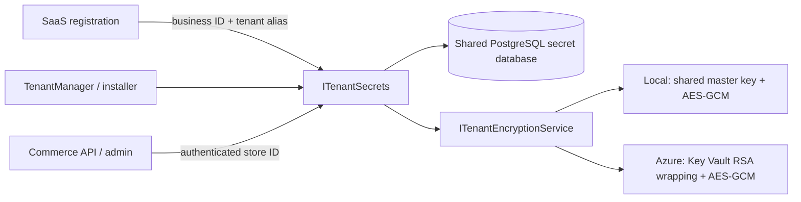

# Shared tenant encryption and secret storage

The .NET services use `Shared/Platform.Security`. `ITenantEncryptionService` selects Local or Azure through DI; `ISecretStore` persists encrypted values; `ITenantSecrets` resolves a stable business identity and its aliases. There is no implicit provider fallback and no secret generation on reads.



## Registration and access

1. SaaS saves the business ID and unfinished registration state. It provisions frontend/backend API secrets using `Business.Id` in `N` format as the canonical identity. The business subdomain is a unique alias. A conflicting alias fails instead of granting access to another business.
2. Only after provisioning succeeds is the registration step completed. If the secret store is unavailable, retry resumes the persisted business. Existing keys survive repeated and concurrent provisioning.
3. `RegisterStoreCommandHandler` checks business ownership, stores database credentials and the initial account password, then publishes a message containing `TenantId`. Database/password values are removed from both Redis publication and the returned response. SaaS `DatabaseConfig` stores a reference rather than another plaintext credential copy.
4. TenantManager resolves the credentials from the same store into a private working copy. Installer child processes inherit the same security configuration. Credential environment values are no longer printed in job output.
5. Installer completion messages also omit database/password/client secrets; backend account passwords remain in the encrypted store. SaaS stores secret references in integration settings and queues build configuration without a client secret. The worker resolves that secret only at execution time.
6. The installer binds GrandNode's store ID to the canonical business. API signing secrets can then be read by business ID, subdomain or store ID. Keycloak client secrets and Android signing material are persisted through the same tenant API.
7. Missing tenants/secrets, denied permissions and decryption failures propagate. Commerce no longer uses a default-tenant key on failure and does not keep a one-hour per-process secret cache.

`ITenantSecrets` is a trusted backend interface, not an end-user authorization API. Never expose a raw secret endpoint to mobile/web clients. Authenticate/authorize the business before choosing a tenant ID; the commerce adapter uses its validated request tenant. Backend identities can access the tenant data granted to their database role.

```csharp
// Inject ITenantSecrets in a trusted service after authorizing the business.
var connection = await secrets.GetAsync(businessId.ToString("N"),
    TenantSecretNames.DatabaseConnection, cancellationToken);
await secrets.SetAsync(businessId.ToString("N"), "integration-token",
    tokenFromAuthorizedSetup, cancellationToken);
```

## Local demo

Run the existing `python3 scripts/demo.py up` command. It creates a separate `commerce_secrets` database in the demo PostgreSQL, generates one 32-byte master key at `.local/secrets/platform-master-key` and gives all hosts the same configuration. Application data and secrets use separate databases so initial SaaS schema creation remains independent.

Local encryption requires both `Development` and `LocalDemo:Enabled=true`. `PlatformSecurity:Local:MasterKeyBase64` or `MasterKeyFile` is mandatory; a reader never invents a master key. Derived tenant keys use HMAC-SHA256 with a domain-specific prefix; payloads use AES-256-GCM with a random nonce and tenant context authentication. Database records also authenticate scope/name inside the encrypted record.

For multiple development machines/containers, use one reachable PostgreSQL endpoint and distribute **the same master key** through protected environment variables or a mounted secret. A file path on one machine is not a shared secret service. Container connection strings use the database service hostname, not `127.0.0.1`. Do not copy per-machine generated keys. A startup probe rejects a replica with an incorrect master key before it serves traffic.

`demo.py prepare` also writes `.local/tenantmanager.json` for the worker's security configuration. The regular demo deliberately does not start cloud provisioning or the mobile build worker.

## Azure deployment

All participating services and installer processes need the same values for:

- `PlatformSecurity:Provider=Azure`
- `PlatformSecurity:ConnectionString`: the shared secret PostgreSQL database; use TLS and separate role credentials.
- `PlatformSecurity:Azure:VaultUrl`: the same HTTPS vault endpoint.
- `PlatformSecurity:Azure:KeyName`: an existing RSA wrapping key, e.g. `tenant-data`.

A deployment administrator provisions the RSA key. Application startup never creates or rotates it. Give writing services Key Vault `get`/`wrapKey`/`unwrapKey`; decrypt-only services need `get`/`unwrapKey`. `DefaultAzureCredential` uses the service's configured identity. Existing card processing/bootstrap configuration may additionally need legacy Key Vault secret/key permissions; these are separate from tenant secret storage.

New ciphertext uses `psec:azure:v1:` and contains the exact wrapping key version. Each write uses a fresh AES-GCM data key, wrapped by Key Vault RSA-OAEP-256. Reads use the recorded key version and reject a key ID outside the configured vault/key. Keep old key versions enabled while their ciphertext remains in use.

Before starting normal services, create the dedicated database and prepare an ignored configuration file based on `config/platform-security.azure.example.json`. Supply actual values through a deployment secret mechanism. Run once with a schema-owner database identity, `InitializeSchema=true`, and `ReadOnly=false`:

```sh
DOTNET_ENVIRONMENT=Production dotnet run --project tools/Platform.Security.Cli -- initialize /absolute/path/to/security-config.json
```

The command creates `platform_security` tables and imports configured `BootstrapSecrets` without printing values. For existing deployments explicitly supply required global credentials such as `ClientSecret-<service-client>`, `ClientSecret-<admin-client>` and `applicationdb`; runtime global reads no longer silently fetch or generate missing values. Bootstrap uses insert-if-absent, so it does not rotate existing credentials.

Set `InitializeSchema=false` for ordinary services. Give SaaS registration, installer and build workers writer access. Give commerce readers `ReadOnly=true` and a database identity with **only SELECT** on the security tables. The flag protects accidental calls; database grants enforce permissions independently. Example grants after creating roles securely:

```sql
GRANT USAGE ON SCHEMA platform_security TO platform_reader, platform_writer;
GRANT SELECT ON ALL TABLES IN SCHEMA platform_security TO platform_reader;
GRANT SELECT, INSERT, UPDATE ON ALL TABLES IN SCHEMA platform_security TO platform_writer;
```

Database passwords/master keys belong in environment/deployment secrets, not checked-in JSON. Back up both the database and its encryption key material. Database durability comes from PostgreSQL; this change does not turn the existing Redis Pub/Sub orchestration into a durable queue/outbox.

## Compatibility and deployment scope

- Original source repositories are unchanged. The shared project is referenced by the new monorepo only. Docker builds must use the **monorepo root** as build context (`docker build -f Ecommerce/Dockerfile --build-arg BUILD_TYPE=Frontend .`, or `-f SaasManager/Dockerfile .`).
- Old Azure RSA and hybrid JSON payloads retain read support using their original tenant keys. Those legacy payloads have no recorded key version; they require the originally used key to remain resolvable. No automatic production-data migration or key rotation is performed.
- Old local demo payloads had per-file keys and no format marker. `demo.py up` re-seeds synthetic claims with the new provider; it preserves databases. Keep old files until any non-demo data has been migrated deliberately.
- Existing cloud tenants need their canonical identity/aliases and API/client/signing secrets imported before switching readers. This is a coordinated migration: do not let old and new writers use different stores. Provider/master-key changes require explicit re-encryption, not merely changing a setting.
- The local demo still disables cloud/billing registration endpoints. Application-level registration tests exercise the actual handlers; no paid Mongo Atlas, Azure/Firebase provisioning, real card processing or app-store publication was invoked.
- Android signing-secret creation now fails on access/decryption errors and uses the committed winner of concurrent writes. The legacy mobile build pipeline itself has not been executed as part of this change.

## Verification

```sh
dotnet test tests/LocalDemo.Tests/LocalDemo.Tests.csproj -c Release
(cd SaasManager && dotnet test ../tests/Registration.Security.Tests/Registration.Security.Tests.csproj -c Release)
python3 scripts/demo.py up
python3 scripts/test_distributed_security.py
python3 scripts/demo.py smoke
```

The distributed test creates and drops only its own randomly named test database. Separate .NET processes simulate registration, worker and commerce roles; tests cover cross-process reads/decryption, concurrent provisioning, alias ownership, missing-secret failures, read-only access, encrypted database rows and mismatched deployment keys. Azure provider tests use mocked SDK clients plus real local RSA/AES operations; live Azure credentials/RBAC/network access are not validated by them.

API references: [Npgsql data sources and transactions](https://www.npgsql.org/doc/basic-usage.html), [Azure CryptographyClient](https://learn.microsoft.com/dotnet/api/azure.security.keyvault.keys.cryptography.cryptographyclient).
